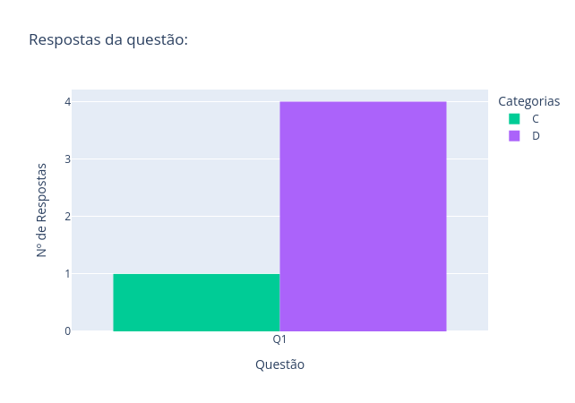
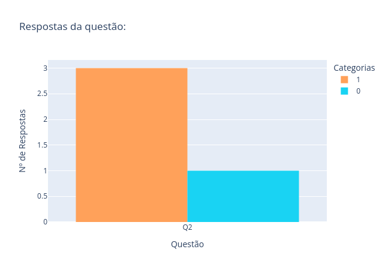
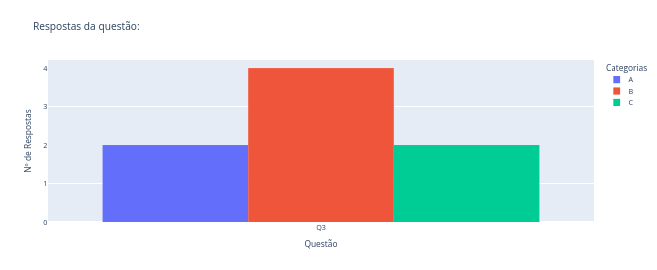
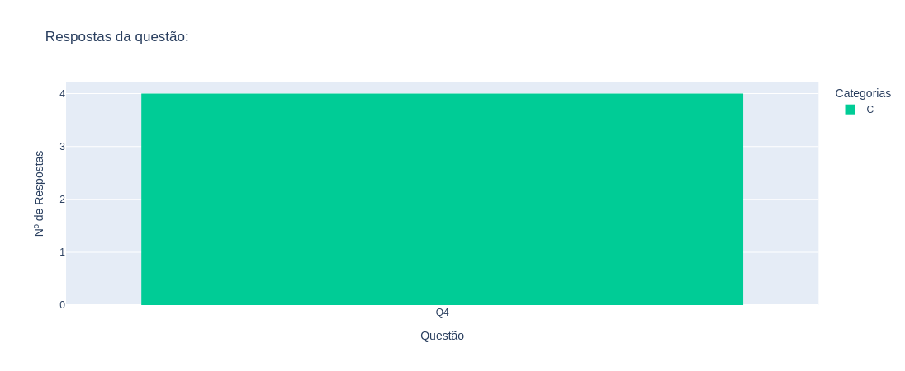
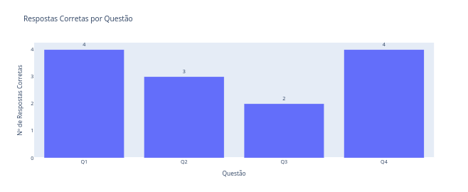

# Internet: A rua está na palma das mãos

## Equipe

| Nome | RA | Curso |
| --- | --- | --- |
| `Paulo César Campos de Pinho` | `212241` | `Matemática Aplicada (28)` |
| `Vitor Hugo Silva` | `295899` | `Matemática (01)` |
| `Luís Gabriel Belotti Simionato` | `254432` | `Física (04)` |
| `Maria Eduarda Villéla Silva` | `212974` | `Estatística (02)` |

## Proposta

O projeto é uma oficina sobre como reconhecer, prevenir e denunciar golpes digitais direcionados a idosos. A atividade será guiada por uma apresentação sobre ocorrências comuns no cotidiano brasileiro e incentivará a discussão aberta da experiências vividas pelos alunos. Durante a exposição, os participantes poderão responder a um formulário com questões pertinentes ao conhecimento recém-adquirido.

## Problema e Contexto

De acordo com o Centro Regional de Estudos para o Desenvolvimento da Sociedade da Informação (Cetic.br) em [3], um a cada três brasileiros usuários da internet sofre tentativas de golpe com dados pessoais. Isso não apenas revela um aumento na prática de crimes virtuais com finalidade finaceira, mas também a insegurança à qual os dados pessoais de muitos estão submetidos.

Em especial, grupos de idosos se sentem mais vulneráveis a tais ameaças, como apontado pela Agência Brasil [2]. Seja pela inexperiência com tecnologias digitais, pela necessidade de auxílio por familiares próximos ou pela falta de informação, eles são frequentemente alvos de websites, empréstimos e serviços falsos. Portanto, observa-se a necessidade de políticas de proteção e conscientização voltadas para esse grupo.

## Público

Estatísticas da Cetic.br [4] dizem que a faixa etária 60+ é a que cada vez mais adere ao uso de TIC's, em especial pelo uso de smartphones. Isso se dá especialmente em razão da informatização de serviços sociais como o INSS e da recente pandemia da Covid-19. Consequentemente, observa-se uma inserção precipitada de idosos no meio digital, no lugar de uma inclusão acessível e segura.

Apesar disso, o uso e a habilidade no manuseio dos TIC's varia significantemente com a idade (60-74 ou 75+), escolaridade, situação econômica, etc. Portanto, a comunicação adotada deve ser capaz de capturar experiências atuais e passadas vivenciadas nesses diversos contextos (seguindo conceitos dados por Apuena Vieira et al. [1]). Por exemplo, um aluno pode utilizar apenas um aparelho celular simples para realizar e receber ligações, de modo que, caso desconheça os desdobramentos tecnológicos recentes, pode não perceber que a voz do outro lado da chamada é gerada por Inteligência Artificial (IA). Em contrapartida, outro pode estar mais familiarizado com as demais funcionalidades dos smartphones e demonstrar ciência de vários riscos da internet, mas ainda ter dificuldades de distinguir páginas falsas de websites de varejo.

Por fim, é preciso ter em mente que despertar o interesse desse público em cibersegurança é essencial para superar a dificuldade (ou até relutância) frequentemente demonstrada em aprender a lidar com as novas tecnologias. Consequentemente, pode ser benéfico evitar uma linguagem excessivamente técnica e incentivar discussões realizadas pelo próprios idosos em abordagens sobre esse tema.

## Objetivo Geral

Desenvolver o senso crítico e a desconfiança dos participantes ao navegar na internet por meio de questões e exposição a casos reais de golpes digitais.

## Experiência

A oficina se iniciará após a preparação antecipada da sala e da chegada de um número mínimo de participantes.

Primeiramente, será feita uma apresentação em slides composta por casos reais de golpes digitais (relacionados ao INSS, links falsos de websites, mensagens de WhatsApp direcionadas, etc.) seguidos de passos para reconhecê-los. 
Os tópicos selecionados foram: 

- Golpes por mensagens de WhatsApp: Pedido de dinheiro emprestado por um parente, métodos de verificação de identidade;
- Golpes relacionados ao INSS: Bloqueio imediato de benefícios, funcionários falsos, canais oficiais de comunicação do INSS;
- Websites e anúncios de vendas falsos: Promoções mirabolantes e verificação de url falsa;
- Proteção de dados e cibersegurança: cuidado ao compartilhar dados que podem ser usados em golpes digitais;
- Decisões a serem tomadas após cair num golpe: interromper diálogo, coletar provas, registrar boletim de ocorrência, etc. O mais importante é agir com calma.

Estatisticamente, esse é o grupo etário mais vulnerável aos golpes mencionados e frequentemente.
Durante a apresentação, serão feitas perguntas ao público, os quais
Assim, busca-se desenvolver os quatro tópicos levantados no questionário de modo que os integrantes da atividade possam compartilhar suas experiências.

Dedicaremos 10 minutos após a apresentação para o preenchimento das questões do formulário ligados aos tópicos desenvolvidos durante a oficina. As perguntas serão majoritariamente fechadas e exigirão pensamento crítico do participante. Abaixo estão os tópicos de cada pergunta, as quais são descritas mais detalhadamente em [guia-de-questoes.md](./formularios/guia-de-questoes.md):

- Meios seguros de compras pela Internet;
- Identificar indícios que um site de varejo seja falso;
- Verificar veracidade de um novo contato familiar;
- Evitar golpe do cartão clonado.

 Os participantes estarão livres para discutir suas respostas.

Em seguida, serão coletadas as respostas e entregue um novo formulário de Feedback, a fim de avaliar a execução da atividade e aprimorar a oficina para uma segunda oferta.

Por fim, entregaremos três cartilhas do CERT.br (“Golpes: Não se deixe enganar”, “Golpes: Evite fraudes” e “Golpes: Caiu? Veja o que fazer”) a cada participante. Será explicado brevemente sobre quem são nic.br e CERT.br e o seu papel na cibersegurança brasileira.Registraremos o momento por fotos. Sugestões e questões levantadas deverão ser consideradas para uma próxima realização.

### Roteiro da Atividade

| Etapa | Duração | Atividade | Participação do público | Recursos |
| --- | ---: | --- | --- | --- |
| Conscientização | 30min | Apresentação dos slides. | Participam ativamente da discussão fazendo perguntas e trazendo relatos. | Apresentação em slides|
| Teste de aprendizado | 15min | Entrega de ambos os formulários. | Preenche os formulários e discute as respostas. | Formulário de Questões e de Feedback |
| Entrega das Cartilhas | 5min | As cartilhas são entregues; uma breve explicação sobre o CERT.br.  | Verificam rapidamente o conteúdo das cartilhas. | Cartilhas impressas do CERT.br |

**Duração total estimada:** 50min.

Mais detalhes sobre a apresentação dos slides se encontram em [Roteiro.pdf](Roterio.pdf).

## Planejamento da Primeira Aplicação

### Articulação para a Primeira Aplicação

- **Público previsto:** 60+;
- **Contexto de aplicação:** Sala 221 do Instituto de Matemática, Estatística e Computação Científica (IMECC);
- **Número estimado de participantes:** 20
- **Período previsto:** 16/10/2026

**Estado atual da articulação:**  
Foi realizado contato com o projeto UniversIDADE, por meio de e-mail, no qual explica-se a proposta e requisita-se que a oficina seja ofertada aos seus participantes.

Após o aceite do pedido, um panfleto de divulgação foi encaminhado à UniversIDADE com as orientações de inscrição, data, local e horário da oficina. As inscrições foram gerenciadas por um formulário do Google Forms e exigem apenas algumas informações de contato. A divulgação ocorreu com atraso em vista de uma reformulação do panfleto e uma mudança na data de realização (mudança de reserva de sala por parte da secretaria do IMECC).

### Alternativas e Contingências

Caso a parceria com UniversIDADE não seja confirmada, será necessário recorrer a meios de divulgação da Unicamp e/ou IMECC de forma mais ampla...

## Plano de Desenvolvimento


| Entregável / Resultado | Tarefa | Responsável(is) | Prazo | Situação |
| --- | --- | --- | --- | --- |
|Sala Reservada | Reservar sala de aula do IMECC. | Vitor | 11/10 | Concluída
|Cartilhas do CERT.br| Enviar e-mail para a CERT.br com pedido de impressão das cartilhas.| Vitor| 22/09 | Concluída |
|Inscrição| Criar um documento Google Forms com coleta de dados de contato dos inscritos| Vitor | 11/10 |Concluída|
| Apresentação em Slides | Definir o modelo e escrever cada seção. | Todos | 14/10 | Concluída |
| Panfleto de Divulgação | Definir informações essenciais para divulgação; criar design agradável. | Luís | 11/10 | Concluída |
| Formulário de Questões | Formular questões e escrever guia. | Todos | 14/10 | Concluída |
| Formulário de Feedback | Formular Feedback necessário para a 2º realização. | Vitor | 16/10 | Concluída |
| Teste da oficina | Verificar condições da sala, tempo de duração e possíveis adaptações. | Todos | 15/10 | Concluída |

### Dependências Críticas

- Confirmação de divulgação por parte da UniversIDADE e coleta mínima de inscrições;
- Confirmação da reserva da sala.

## Materiais e Recursos

### Materiais a Desenvolver

- Panfleto de Divulgação. 
   - Arquivo: [panfleto-divulgacao.jpeg](panfleto-divulgacao.jpeg);
   - Canva: [Divulgação](https://canva.link/q0q9on2eluu2671);
- Formulário de inscrição: [Inscrição](https://docs.google.com/forms/d/1w0ykZHoaeEDC5no8zp8Ra-lzfm0lTqewFhf7DJNFpBQ/closedform);
- Roteiro de apresentação.
   - Arquivo: [Roteiro.pdf](Roteiro.pdf);
- Slides: 
   - Arquivo: [Oficina-ciberseguranca.pdf](Oficina-cirberseguranca.pdf);
   - Canva: [Oficina de Cibersegurança](https://canva.link/9e1sunoia5bolkj);
- Formulário de questões.
   - Arquivo: [Formulario-questoes.pdf](./formularios/Formulario-questoes.pdf);
   - Canva: [Questionário](https://canva.link/oy26cn72eb9ujvb);
- Guia de questões: [guia-de-questoes.md](./formularios/guia-de-questoes.md);
- Formulário de Feedback.
   - Arquivo: [Formulario-feedback.pdf](./formularios/Formulario-feedback.pdf);
   - Canva: [Feedback](https://canva.link/rxdc3ozg4wrwfid);

### Recursos para a Aplicação

- Computador e projetor para a apresentação em slides;
- Cópias impressas dos slides;
- Cópias impressas das três cartilhas do CERT.br;
- Cópias dos formulários para cada participante;
- Canetas para o preenchimento dos formulários.

### Testes Necessários

- Duração média da apresentação;
- Adaptação da apresentação no caso do projetor estar indisponível;
- Tamanho da fonte dos materiais. Isso pode ser verificado com cópias de teste do material.

## Avaliação

### Indicadores de Sucesso

| Objetivo | Indicador / Evidência |
| --- | --- |
| Bom ritmo de apresentação | Engajamento dos participantes ao longo da apresentação; tempo de duração. |
| Compreensão do conteúdo | Respostas dos formulários. |
| Alcance da divulgação | Número total de participantes. |

### Coleta de Evidências e Feedback

- O tempo gasto na apresentação dos slides e no preenchimento dos formulários será mensurado. O engajamento dos participantes deverá ser observado com atenção durante a realização.
- Após o término da atividade, as respostas dos formulários de questões do feedback serão armazenadas anônimamente num arquivo CSV. Com esses dados, será feita uma análise estatística simples (com gráficos e tabelas) para determinar as questões com mais acertos e erros, quais alternativas foram selecionadas e elaborar explicações sobre como o que foi dito na apresentação influenciou as respostas. 
- Será registrado o número de participantes presentes por fotos e pelo número de cartilhas entregues. Será importante também verificar a quantidade de inscritos que não compareceram à atividade, informação que será obtida pelo Google Forms.

## Riscos e Desafios

| Risco / Desafio | Possível impacto | Estratégia |
| --- | --- | --- |
| Legibilidade do Material | O tamanho da fonte pode ser pequena, prejudicando a sua legibilidade. | Durante a produção do material, serão usadas fontes grandes (>16pt documento, >32pt slides) e com alto contraste.|
| prolongamento excessivo da apresentação (>1h) | Cansar os participantes; perda de interesse. | Cortar certas seções dos slides; agilizar a apresentação.|
| Indisponibilidade dos equipamentos da sala | Impedir a apresentação dos slides. | Os equipamentos serão testados com uma hora de antecedência e um computador extra será levado. Em caso de impossibilidade total, a apresentação será feita com cópias impressas dos slides. |

## Primeira Aplicação — Registro e Análise

### Contexto da Aplicação


- **Data ou período:** 16/10/2026, das 15h às 16h
- **Local/contexto:** Auditório do IMECC.
- **Público atendido:** 60+
- **Número aproximado de participantes:** 4
- **Duração efetiva:** 1h10min

### O que Aconteceu e o que Aprendemos


   A oficina foi realizada com 4 participantes, sendo 3 deles inscritos e 1 acompanhante. Esse número está abaixo do esperado e a sua principal causa foi o adiamento da sua divulgação pelo UniversIDADE. Isso ocorreu pois a diretoria do IMECC alterou a reserva da sala 221 para o auditório no dia 13/10/2026, logo o material de divulgação teve que ser reformulado.

   Apesar disso, a oficina em si não foi prejudicada pela mudança de sala: o auditório possui mais espaço, possui mais equipamentos e é mais próximo da entrada do IMECC, tornando-o mais fácil de encontrar. Ainda sim, ela começou com 15 minutos de atraso: 2 participantes chegaram atrasados e foi necessário guiá-los ao auditório.

   Iniciada a oficina, a apresentação em slides durou 40 minutos (considerado um tempo razoável pelos participantes). Os participantes foram bem conversativos tanto entre si quanto com os apresentadores, de modo que suas observações também foram úteis para que possamos aprimorar a disciplina. Um comentário notável de um participante foi a sugestão sobre o uso de cartões virtuais em compras online, algo será adicionado à segunda realização. Acredita-se que a escolha de trazer relatos pessoais de parentes que sofreram golpes também tenha ajudado a capturar a empatia dos participantes. Aqui concluímos que a apresentação foi capaz de estimular o interesse e a discussão por parte dos participantes em cibersegurança.

   Finalizada a apresentação, os formulários foram preenchidos no tempo estipulado (15 minutos). No momento, foi permito assinalar mais de uma alternativa em cada questão, o que não será repetido na segunda aplicação. Decisão tomada pois, além de tornar a análise das respostas mais complicada, acredita-se que isso prejudique a observação das nuâncias que tornavam uma alternativa mais segura que a outra. Pelo mesmo motivo, não discutir as respostas dos formulários foi considerado um erro, pois isso poderia corrigir as respostas incorretas do questionário que observamos posteriormente. Ainda sim, a maioria das repostas estavam corretas, logo a apresentação em grande parte foi capaz de transmitir o que pretendiámos.

   Por fim, foram entregues cada das três cartilhas do CERT.br aos participante, as quais foram muito bem recebidas. Embora a função das cartilhas seja como um brinde pela participação, consideramos que seja importante levar ao público o papel do orgão na cibersegurança brasileira de modo mais aprofundado. Planeja-se, portanto, incorporar dados sobre o CERTIC na apresentação e durante a entrega.

### Evidências e Feedback

Na pasta [aplicacao-1](./aplicacao-1/) encontram-se:
- O registro por foto de todos os formulários preenchidos (sem identificação);
- A versão utilizada dos slides;
- Uma tabela com os dados coletados ([resposta.csv](./aplicacao-1/respostas.csv));
- As provas de realização da oficina e entrega das cartilhas ([aplicacao-1/registros](./aplicacao-1/registros/));
- Os gráficos gerados com os dados coletados ( [aplicacao-1/dados](./aplicacao-1/dados/)).

Caso seja desejável, o script [app.py](./aplicacao-1/app.py) cria um dashboard com uma visualização aprimorada dos gráficos e da tabela. Para executá-lo no terminal (Unix), crie um ambiente virtual python na pasta do projeto e instale as dependências necessárias

```sh
python -m venv .venv
python -m pip install -r requirements.txt
```
Em seguida, execute o código no terminal
```sh
python ./aplicacao-1/app.py
```
e digite a URL http://127.0.0.1:8050/ no navegador para visualizar o dashboard.

#### Formulário de Questões

Apresentam-se abaixo os gráficos com a quantidade de respostas para cada questão, as quais serão analisadas com base no [guia-de-questoes.md](./formularios/guia-de-questoes.md). Repare que a soma das respostas pode ser maior que 4 pois alguns participantes assinalaram mais de uma letra por questão.







Nesse último gráfico, uma resposta foi considerada correta desde que uma das alternativas assinaladas seja a esperada.

| Questão| Observação |
| --- | --- |
| Q1. (Compras pela Internet) | Todos os participantes assinalaram a alternativa mais segura. Um participante respondeu c), a qual é aceitável se estiver acompanhada com d) |
| Q2. Site da Americanas | 3 dos 4 participantes identificaram que a página era falsa pelo link do site apresentado pela imagem. Um deles, entretanto, afirmou que confiaria na página pois a identidade visual se assemelha à da loja física.|
| Q3. Contato Familiar | Considerada a mais difícil, a) e b) são aceitáveis. A c) poderia ser correta caso fosse mencionado apenas videochamadas. Felizmente, ninguém assinalou d).|
| Q4. Cartão Clonado?| Todas as respostas estão corretas. As alternativas incorretas são bem similares, o que pode ter ajudado os participantes.|

No geral, podemos ver que a maioria dos tópicos centrais tratados na apresentação (identificação de links falsos, uso de canais oficiais de instituições, etc.) se refletiram nas respostas. Na Q2, será benéfico incluir na apresentação que a identidade visual site não é garantia de confiabilidade. Já na Q3, acredita-se que discutir as respostas após o preenchimento pode ajudar o público a compreenderem as nuâncias das três abordagens.

#### Formulário de Feedback

| Feedback | Concordo totalmente | Concordo| Indiferente| Discordo| Discordo totalmente|
| --- | --- | --- |--- |--- |--- |
| Sinto-me mais preparado(a) e desconfiado(a) na internet | 3 | 1 | 0 | 0 | 0 |
| Aprendi algo de novo | 4 | 0 | 0 | 0 | 0 |
| O tema deve ser mais discutido com pessoas da minha faixa etária | 4 | 0 | 0 | 0 | 0 |
| A apresentação foi fácil de entender | 4 | 0 | 0 | 0 | 0 |
| O evento cumpriu as suas expectativas | 4 | 0 | 0 | 0 | 0 |
| A duração total do evento foi adequada | 3 | 1 | 0 | 0 | 0 |

3 dos 4 participantes preencheram o campo livre, todos com comentários positivos. Conclui-se pelo feedback que as principais preocupações técnicas sobre a oficina (como tempo de duração)

#### Limitações
- A amostra é muito pequena, logo os dados podem não avaliar a oficina precisamente.
- Não foi realizado um pre-teste, logo é possível que algum conhecimento avaliado já era conhecimento prévio do participante.
- Não foi possível verificar a eficiência da divulgação em razão do baixo número de inscritos.
- Embora o tempo de duração tenha sido razoável, ele ainda depende da participação do público. É possível que a sua duração seja maior para públicos maiores.

## Plano de Aprimoramento para a Segunda Aplicação

| Evidência ou dificuldade observada | Ajuste proposto | Resultado esperado |
| --- | --- | --- |
| Poucos participantes |Ampliar os canais de divulgação, buscando redes de conexão com conhecidos e colegas de classe: solicitar a terceiros que divulguem a atividade em grupos com grande concentração de nosso público-alvo; realizar a divulgação em associações de bairro, condomínios e demais canais do UniversIDADE, bem como nas redes sociais da FEEC; busca-se incentivar os participantes a trazerem um conhecido para participar da atividade. Também pretede-se iniciar a divulgação com mais antecedência.| Aumentar o número de participantes, gerando uma base dados maior para análise posterior.|
| Falta de acompanhamento e mudanças de reserva | Será criado um grupo de Whatsapp, o qual estará presente em todos os meios de divulgação, pelo qual os inscritos serão notificados em caso de mudança de local ou horário. | Tornar a aplicação mais robusta a mudanças na reserva e reduzir o índice de não comparecimento.  |
| Dificuldade para encontrar o auditório. | Será gravado um vídeo com instruções de como chegar ao local que será enviado pelo grupo de Whatsapp; na data da oficina, serão postos panfletos nas facilidades do IMECC para guiarem os participam| Espera-se que os participantes consigam encontrar facilmente o ambiente da atividade, diminuindo atrasos. |
| Falta de indicadores sobre a efetividade dos canais de divulgação | Incluir no formulário de inscrição uma pergunta sobre como o participante conheceu a atividade.| Identificar os canais de divulgação com mais alcance para o público 60+.|
| Evidência limitada para a prestação de contas ao CERT.br.|Incluir tópico sobre a autorização para o uso de imagem no formulário de inscrição.| Registro fotográfico mais amplo do evento.|
|Falta de dicussão sobre as questões após preechimento dos formulários| Serão incluidos slides no final com as questões e as alternativas corretas.| Garantir que as orientações corretas tenham sido transmitidas ao público mesmo se as respostas estiverem erradas.|


### Preparação da Segunda Aplicação

- **Situação da segunda aplicação:** Divulgação realizada pela UniversIDADE e pelos grupos de Whatsapp obtiveram 23 inscrições. A oficina possui reserva para o auditório do IMECC às 15h00 do dia 13/11/2026. Todos os inscritos foram instruidos a chegar ao local pelo grupo de Whatsapp.

| Entregável / Resultado | Tarefa | Responsável(is) | Prazo | Situação |
| --- | --- | --- | --- | --- |
|Sala Reservada | Reservar o auditório do IMECC. | Vitor | 12/10 | Concluída|
|Inscrição| Atualizar Google Forms com o novo grupo do Whatsapp| Vitor | 05/10 |Concluída|
|Orientações de chegada ao local| Gravar vídeo de como chegar à sala reservada| Maria Eduarda | 11/10 |Concluída|
| Apresentação em Slides e Formulários | Adicionar dados do CERT.br e discussão sobre as questões no final. | Paulo | 09/10 | Concluída |
| Teste da oficina | Verificar condições da sala, tempo de duração e possíveis adaptações. | Todos | 12/10 | Concluída |

   O material dos slides e dos formulários foi reimpresso, uma vez que ele foi adaptado em razão das mudanças da segunda aplicação.
- **Pendências prioritárias:** Não há.
- **Como verificaremos as melhorias:** 
   - Aumento no número de pessoas; 
   - Coerência entre o número de inscrições e o de pessoas presentes;
   - Será perguntado se houve dificuldades em chegar ao local;
   - Mais registros fotográficos da oficina;
   - Maior coleta de respostas dos formulários permitirá uma melhor avaliação da qualidade da oficina. 

## Referências

1. Vieira, Apuena, et al. "Definição de um design instrucional e sua aplicação sobre prevenção de golpes na internet para pessoa idosa." Nuevas Ideas en Informática Educativa 18 (2022): 184-189.
2. Idosos sentem maior vulnerabilidade a golpes online em SP. Disponível em: <https://agenciabrasil.ebc.com.br/direitos-humanos/noticia/2026-03/idosos-sentem-maior-vulnerabilidade-golpes-online-em-sp >. Acesso em: 9 set. 2026.
3. Um em cada três usuários de Internet no Brasil relatou sofrer tentativa de golpe com uso de seus dados pessoais, aponta Cetic.br. Disponível em: <https://cetic.br/pt/noticia/um-em-cada-tres-usuarios-de-internet-no-brasil-relatou-sofrer-tentativa-de-golpe-com-uso-de-seus-dados-pessoais-aponta-cetic-br/>. Acesso em: 9 set. 2026.
4. Violeta Sun, Luisa Veras de Sandes-Guimarães e Marcelo Henrique de Araujo3. Ano XI - N. 1 - Práticas digitais móveis das pessoas idosas no Brasil. Disponível em: <https://cetic.br/pt/publicacao/ano-xi-n-1-praticas-digitais-moveis-das-pessoas-idosas-no-brasil/>. Acesso em: 10 set. 2026.
5. Angelini, Kelli, et al. #Internet com Responsa 60+: Cuidados e responsabilidades no uso da Internet. Disponível em: <https://nic.br/publicacao/internet-com-responsa-60-cuidados-e-responsabilidades-no-uso-da-internet/>. Acesso em: 10 set. 2026.
