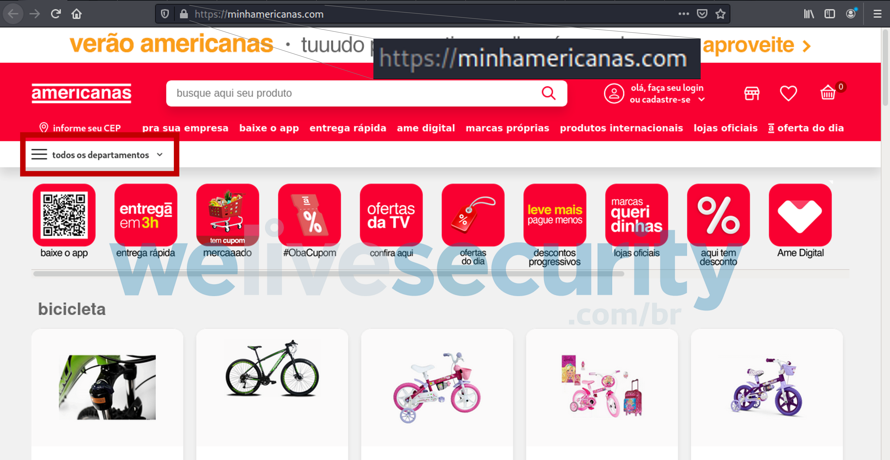

# Lista de Questões

Sugestão de questões para o formulário:

## Questão 1: Compras pela Internet

O objetivo desta questão é incentivar o uso de ferramentas como o website [www.siteconfiavel.com.br](https://www.siteconfiavel.com.br/para-comprar) e o [ReclameAqui](https://www.reclameaqui.com.br/detector-site-confiavel/) para verificar a reputação de empresas e a url correta da loja antes de realizar compras pela internet. 

**Questão:** Suponha que você queira comprar um produto pela internet. Qual é a atitude mais segura?

- **a)** Entro em grupos de ofertas e promoções no WhatsApp e acesso os links enviados.
- **b)** Procuro o menor preço na internet e compro imediatamente.
- **c)** Só compro em lojas indicadas por outras pessoas, evitando sites desconhecidos.
- **d)** Antes de comprar, pesquiso o nome da loja no Google junto com palavras como “reclamação” ou “golpe” e leio a experiência de outros clientes.

As alternativas a) e b) não identificam nenhuma forma de garantir a autenticidade das vendas ou das lojas virtuais. c) pode ser útil, mas não é robusto contra sites fraudulentos. d) apresenta um bom método de prevenção contras golpes por vendas e, portanto, é a resposta esperada.

## Questão 2: Site (Falso) da Americanas

O website www.welivesecurity.com [1] divulgou em 2023 uma matéria detalhando o processo de coleta de dados de uma página falso da Americanas. Interessante notar que esse website falso usava protocolo HTTPS, demonstrando que o método "se tiver HTTPS, então é verdadeiro" não é suficiente.

**Questão:** Fonte www.welivesecurity.com [1] 

Observe o cabeçalho do site acima. Você confiaria nesse site? Se sua resposta for não, indique elementos que evidenciem a sua resposta.

A questão pede que o participante analise elementos da página que possam levantar suspeitas acerca de sua veracidade, como a URL (o verdadeiro é https://www.americanas.com.br), escrita (erros ortográficos), ausência de elementos de UI, etc. Será contabilizado como acerto qualquer resposta que conter pelo menos um dos elementos citados.

## Questão 3: Contato Familiar

Uma das categorias de golpes mais comuns no Brasil são os de engenharia solcial, em especial feitas pela plataforma Whatsapp. Vários tipos de golpe desse tipo são descritos por Morgado [2], onde os golpistas se passam por advogados, funcionários de bancos, lojas virtuais, etc. Em particular, selecionamos aquele onde o golpista se passa por um familiar da vítima, alegando que trocou de número e que urgentemente precisa de dinheiro. 

Esse golpe é particulamente perigoso quando o golpista personaliza suas mensagens, o que ocorre se ele tiver conhecimento prévio sobre a vítima (um exemplo é por meio de contatos de um número clonado). Isso significa que a foto de perfil, a forma de escrita e até mesmo aúdios podem simular de maneira precisa o contato verdadeiro.

A questão foca nas ações que permitem verificar se o contato é real.

**Questão:** Tiago acaba de receber uma mensagem do seu filho num número novo, dizendo que está numa emergência e pedindo mil reais. Tiago está preocupado com filho, mas desconfia da mensagem. O que você sugere para ajudá-lo?

- **a)** Tentar se comunicar com o filho por um contato antigo e/ou outros meios.
- **b)** Fazer uma pergunta para a qual somente Tiago e seu filho saibam a resposta.
- **c)** Pedir um áudio, uma foto ou uma videochamada.
- **d)** Verificar se o filho está na foto de perfil e o DDD do contato.

A questão d) está claramente errada: o DDD e a foto de perfil são as informações menos robustas contra golpes. c) poderia ser um bom indicador, porém aúdios e fotos podem ser gerados com ferramentas de IA. a) e b) são as melhores opções, porém como a) é um procedimento mais geral, considera-se essa como a alternativa correta.

## Questão 4: Cartão Clonado?

De acordo com Kosh [3], golpes ligados a instituições financeiras são especialmente perigosos por gerarem prejuizos de grande porte e muitas vezes irreparáveis. No geral, eles usam mensagens de urgência para estressar a vítima ("uma conta indevida foi feita com o seu cartão", "sua conta será CANCELADA.", etc.) e buscam envolver o indivíduo para que ele forneça dados cadastrais ou realizem pagamentos para regularizar a situação. Embora seja numa amostra pequena (32 pessoas), Kosh obtém em seu estudo que 59,38% da vítimas desse tipo de golpe possuem de 60 a 79 anos.

A questão proposta ilustra o golpe do Motoboy, onde o golpista acusa a vítima de ter o cartão clonado e compras indevidas.

**Questão:** Você recebe um SMS dizendo que seu cartão foi clonado e que uma compra de R$ 1.850,00 foi identificada. A mensagem informa que, para cancelar a compra, você deve ligar imediatamente para um número indicado no próprio SMS. O que você faria?

- **a)** Ligaria para o número informado no SMS para obter mais informações e cancelar a compra.
- **b)** Responderia ao SMS perguntando quais dados precisam ser confirmados.
- **c)** Não usaria o número do SMS e entraria em contato com o banco por um canal oficial, como o aplicativo ou o número no verso do cartão.
- **d)** Um Pix no valor informado para a chave indicada no SMS com o objetivo de regularizar a conta e obter o reembolso.

Como já explicado, a) está incorreta poi realizar a ligação torna o indivíduo suscetível a entregar dados ao telefonista. Não se recomenda b) pois responder ao SMS confirma ao golpista que a linha telefônica é ativa e monitorada, expondo o indivíduo a novas abordagens persuasivas. d) nunca deve ser feito, pois bancos não exigem pagamentos em Pix para recuperar cartões. A altertiva c) é correta e também é a principal orientação contra golpes de natureza financeira. 

## Referências

1. BARBOSA, Daniel Cunha. Criminosos criam página falsa que se faz passar pelo site da Americanas. Disponível em: <https://www.welivesecurity.com/br/2023/02/02/criminosos-criam-pagina-falsa-que-se-faz-passar-pelo-site-da-americanas/>. Acesso em: 25 set. 2026.

2. MORGADO, Flávio. "Golpes financeiros contra pessoas idosas por meio de engenharia social no ambiente digital." Revista Longeviver (2024).

3. KOCH, Gustavo Duarte Waltereith. Perfil de vítimas de golpes em uma instituição financeira. 2022.