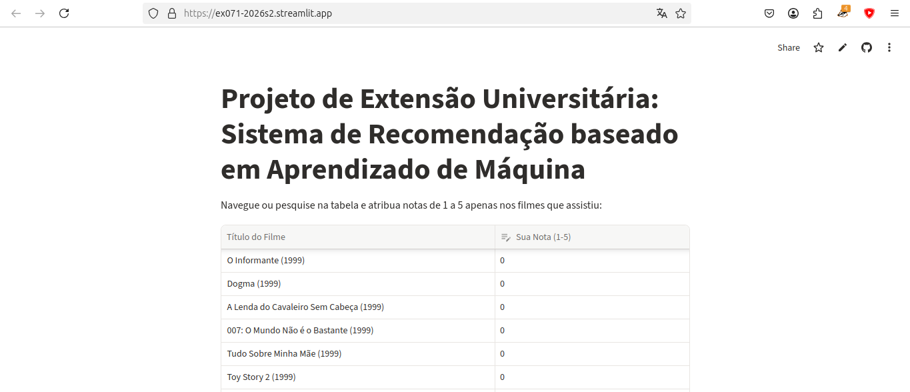
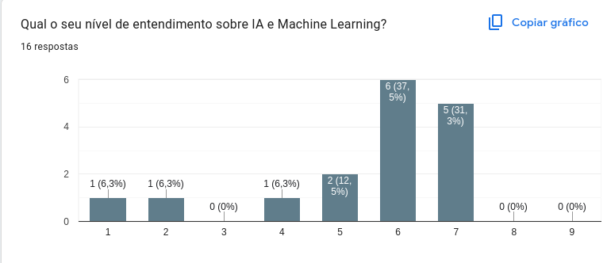
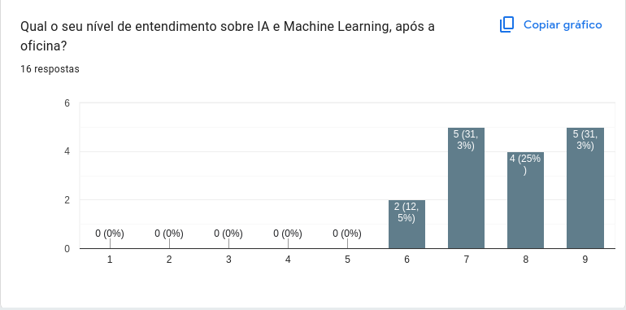
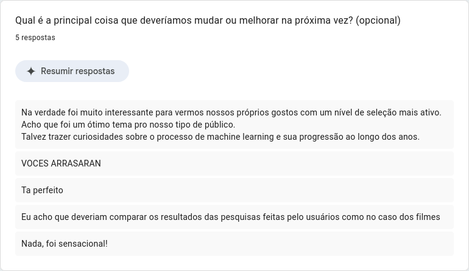

# ECA DIGITAL

## Equipe

| Nome | RA | Curso |
| --- | --- | --- |
| `Júlia Curie Takara Chaves` |  `233837`  | `Engenharia de Alimentos` |
| `Eduardo Penna Lima Guedes de Amorim` | `277141` | `Estatística` |
| `Matheus Pierri de Oliveira` | `277209` | `Estatística` |
| `Wan Tai Cheuk` | `277240` | `Estatística` |
| `Guilherme José de Oliveira Almeida` | `281218` | `Engenharia de Computação` |
## Proposta

> A proposta consiste em uma oficina de 45 minutos para alunos do Ensino Médio, que articula IA (Machine learning) e Cibersegurança a partir de uma experiência prática e reflexiva. Os participantes vivenciam, na prática, como uma Inteligência Artificial utiliza dados de usuários para direcionar avaliações de filmes, e, em seguida, discutem como esses mesmos dados podem ser usados para propósitos que talvez sejam desconhecidos do cidadão. A oficina utiliza os alunos como asmostra para o teste do modelo programado, tentando fornecer conteudos que lhe são interessantes. O objetivo é desenvolver pensamento crítico, consciência sobre o valor dos dados pessoais e autonomia no ambiente digital, formando jovens concientes acerca de como os dados disponibilizados no ambiente online podem ser usados, a fim de terem autonomia durante a gestão de informações pessoais. 

## Problema e Contexto

>Jovens de 16 e 17 anos estão inseridos em um ambiente digital no qual seus dados são coletados, analisados e utilizados por algoritmos de Aprendizado de Máquina para direcionar anúncios, moldar comportamentos e influenciar decisões. A maioria desconhece ou não tem aprofundamento nesse processo e não compreende que suas informações pessoais podem ser usadas tanto para personalização de conteúdo quanto para manipulação, golpes e violações de privacidade. Diante disso, a oficina surge como resposta a essa lacuna, propondo uma experiência prática em que os próprios alunos vivenciam como uma IA aprende com seus dados e refletem sobre os riscos e implicações éticas desse uso, desenvolvendo pensamento crítico e autonomia no ambiente digital.

## Público

>O público-alvo da oficina são adolescentes de 16 e 17 anos, matriculados no Ensino Médio. Essa faixa etária caracteriza-se pelo desenvolvimento do pensamento abstrato e crítico, pela busca de autonomia e identidade, e pela intensa inserção no ambiente digital especialmente em redes sociais, jogos online e plataformas de conteúdo. São nativos digitais que utilizam a internet diariamente, mas, em sua maioria, desconhecem como seus dados são coletados, analisados e utilizados por algoritmos de Machine Learning para direcionar anúncios e influenciar comportamentos. A escolha desse público justifica-se por sua vulnerabilidade a práticas de manipulação digital e pela necessidade de desenvolver competências críticas e éticas sobre o uso da tecnologia, preparando-os para exercer cidadania digital consciente, se proteger e proteger os próximos de riscos como golpes, violações de privacidade e manipulação algorítmica.

## Objetivos

### Objetivo Geral

>Desenvolver pensamento crítico em adolescentes sobre o uso de seus dados por algoritmos de Aprendizado de Máquina, capacitando-os a reconhecer riscos e se protegerem no ambiente digital.

### Objetivos Específicos

> Verifique se os objetivos específicos descrevem resultados que poderão
> ser observados ou investigados durante as aplicações.

-   `Identificar como algoritmos de Machine Learning utilizam dados pessoais para direcionar anúncios e criar perfis de consumo.`
-   `Reconhecer os riscos do uso indevido de dados pessoais, incluindo manipulação, golpes e violações de privacidade.`
-   `Desenvolver atitudes críticas e autônomas de proteção no ambiente digital, refletindo sobre ética, privacidade e cidadania digital.`

## Experiência

> A experiência planejada consiste em uma oficina de 45 minutos, conduzida com o telão como ferramenta central. A atividade começa com uma provocação: “Qual nota você daria para determinado filme?”. Em seguida, os alunos respondem anonimamente a um formulário, avaliando alguns filmes a partir de seus gostos pessoais. Os dados coletados são inseridos em um modelo simples de Machine Learning, que retorna notas prováveis para outros filmes ainda não avaliados por cada aluno, prevendo preferências a partir dos padrões encontrados nas respostas da turma. O organizador projeta no telão algumas dessas previsões e compara com a nota real que o aluno daria, mostrando como o modelo acerta (ou erra) ao “adivinhar” o gosto de alguém só a partir de poucas respostas. A partir disso, é explicado como esse mesmo princípio está por trás das recomendações de plataformas como Netflix, Spotify e YouTube. Na sequência, a discussão se volta para o lado sensível dessa tecnologia: se um sistema consegue prever o que você gosta a partir de poucos dados, essas mesmas informações podem ser usadas para te atingir de forma maliciosa. A oficina se encerra com uma discussão ética, provocada pela pergunta: “Você é o cliente ou o produto?”. O objetivo é levar os alunos a refletirem sobre o valor dos próprios dados, os limites entre personalização e exposição, e a importância de uma postura crítica diante das tecnologias que preveem e moldam seus gostos.

### Roteiro da Atividade

 Etapa       | Duração  | Atividade       | Participação do público | Recursos    |
| --- | --- | --- | --- | --- |
| Abertura e Teoria | 10 min     | O organizador recebe os alunos e introduz o conceito de Machine Learning de forma teórica e acessível, explicando como as máquinas aprendem a partir de padrões de dados. Em seguida, apresenta a dinâmica: eles avaliarão filmes para testar o modelo.  | Os alunos ouvem a explicação e se preparam para a atividade prática. | Telão, slides, celulares |
| Avaliação dos Filmes (Prática)  | 15 min     | Os alunos acessam a plataforma e começam atribuindo notas de 1 a 5 para filmes que já conhecem. O organizador recolhe as respostas para inseri-las no modelo. (ou poderão realizar o próprio teste no celular) | Os alunos avaliam os filmes com base em seus gostos pessoais. | Telão, celular e plataforma |
| Demonstração e Recomendação | 10 min     | O organizador insere as notas no modelo e projeta no telão como a máquina cruza os dados e gera recomendações de novos filmes. O modelo mostra que é capaz de prever o gosto dos alunos com base nas avaliações iniciais. | Os alunos reagem às recomendações, percebendo como a IA usou os dados deles para fazer as previsões | Telão, celular, plataforma |
| Encerramento Focado no Enem (Gemini Notebook) | 10 min     | A oficina encerra apresentando o Gemini Notebook. Mostra-se como a IA (que aprende com dados) pode ser uma aliada prática nos estudos, resumindo PDFs e criando quizzes para o Enem e vestibulares, sem esquecer de alertar sobre não inserir dados sensíveis na ferramenta. | Os alunos acompanham a demonstração e tiram dúvidas sobre como usar a ferramenta para estudar.  | Telão, computador com internet e Gemini Notebook.  |

**Duração total estimada:** 45 minutos.

## Planejamento da Primeira Aplicação

### Articulação para a Primeira Aplicação  

-   **Público previsto:**
    `Alunos de 16 e 17 anos, matriculados no Ensino Médio.`
-   **Contexto de aplicação:**
    `Escola de Ensino Médio (Colégio Marista Arquidiocesano). A atividade será realizada em sala de aula, com o telão como ferramenta central.`
-   **Número estimado de participantes:** `80 alunos (2 turmas)
-   **Período previsto:** `22 de Outubro`

**Estado atual da articulação:**\
`Estamos atualmente conversando com um colégio de São Paulo para ver se é possível viabilizar, além de outras escolas de ensino fundamental de Campinas e Barão Geraldo`

### Alternativas e Contingências

`Temos um projeto secundário, uma ideia ja consolidada caso nao seja viavel com o Ensino Médio de São Paulo, realizaremos com o Ensino Fundamental das escolas primárias, o projeto de Detetives.`

## Plano de Desenvolvimento

| Entregável/Resultado  | Tarefa      | Responsável(is)        | Prazo       | Situação    |
| --- | --- | --- | --- | --- |
| Articulação com a escola | Entrar em contato com o setor responsável da escola  | Wan, Eduardo    | 8/10        | finalizado  |
| Dinamica    | Programação e roteirização da oficina | Julia, Wan       | 8/10        | finalizado        |
| Parte técnica (modelo, e softwares testados)      | Programação dos modelos que serão utilizados | Guilherme, Matheus  | 8/10        | finalizado   |
| Teste piloto     | Aplicar a oficina, coletar e ampliar a base de dados para aperfeiçoar  |Wan, Julia, Eduardo, Matheus e Guilherme        | 12/10       | finalizado   |

### Dependências Críticas

-   Confirmação do público e escola antes de definir o tema e o formato
    da oficina

-   Finalização do roteiro da dinâmica da criação do material

-   Teste dos materiais antes do teste piloto

-   Teste piloto antes de aplicar

## Materiais e Recursos

### Materiais a Desenvolver

-   Modelo de machine learning
-   Gemini Notebook
-   Infograficos ao vivo (opcional)

### Recursos para a Aplicação

> Considere equipamentos, infraestrutura, software, conexão à Internet,
> impressão, acessibilidade e outros recursos necessários no dia da
> atividade.

-   Internet
-   Computador
-   Projetor
-   Celulares (opcional)

### Testes Necessários
-   Formulário de coleta de dados (já testado)
-   Modelo de classificação em perfis (já testadi)
-   Projetor e internet

## Avaliação

### Indicadores de Sucesso

| Objetivo                                                                                                                           | Indicador / Evidência                                                                                                                                                                                                                                       |
|------------------------------------------------------------------------------------------------------------------------------------|-------------------------------------------------------------------------------------------------------------------------------------------------------------------------------------------------------------------------------------------------------------|
| Identificar como algoritmos de Machine Learning utilizam dados pessoais para direcionar avaliações de consumo         | Os alunos conseguem explicar, com suas próprias palavras, como a IA chegou à prováveis avaliações de cada aluno. Durante a etapa de classificação, apontam quais dados foram usados para criar cada avaliação.                                                        |
| Reconhecer os riscos do uso indevido de dados pessoais, incluindo manipulação, golpes e violações de privacidade                   | Os alunos identificam corretamente quais avaliações podem estar sendo induzidas para te atingir de forma maliciosa, justificando suas escolhas. Durante o debate, citam exemplos de como dados podem ser usados para o mal.                                                                     |
| Desenvolver atitudes críticas e autônomas de proteção no ambiente digital, refletindo sobre ética, privacidade e cidadania digital | Os alunos propõem formas de se proteger durante o debate. Questionam o que consomem e por que determinados conteúdos aparecem para eles. Participam da discussão ética com argumentos próprios, demonstrando reflexão sobre responsabilidade e privacidade. |
| Compreender que a IA não é neutra e aprende com os dados que recebe                                                                | Os alunos explicam que a IA pode ser usada tanto para o bem quanto para o mal. Reconhecem que os golpes recomendados pelo chatbot refletem os dados que ele aprendeu.                                                                                       |
| Perceber que seus próprios dados alimentam os algoritmos                                                                           | Os alunos relacionam suas respostas do formulário com as avaliações "adivinhadas" pela IA. Demonstram surpresa ou reflexão ao perceberem que suas escolhas geraram uma provável avaliação par outros filmes que talvez tenham nunca consumido.
### Coleta de Evidências e Feedback

`Coletaremos evidências no começo da oficina e ao decorrer dela analizaremos o comportamento e tomada de decisão dos alunos, e após a aplicação da oficina pediremos feedbacks dos participantes.`

## Riscos e Desafios

| Risco / Desafio      | Possível impacto     | Estratégia           |
| --- | --- | --- |
| Falha na internet ou no projetor| A oficina depende do telão para exibir formulário, e a dinâmica da oficina | Ter plano B com todos os materiais (formulário, oficina, quiz). Testar equipamentos e softwares antes da aplicação.      |
| Falta de engajamento ou resistência dos alunos | Alunos de 16-17 anos podem considerar a atividade "infantilizada", teórica demais, ou não se envolverem no debate.| Começar com uma nova provocação forte e realista ("Qual nota você daria para determinado filme?"). Usar exemplos reais, e linguagem adequada à faixa etária. Evitar tom professoral     |
| Problemas com o modelo ou formulário   | Se o modelo não funcionar, ou o formulário não funcionar, perde o elemento prático de uma oficina     | Testar tudo antes. Ter materiais salvos. Ter versão impressa do formulário como alternativa.  |
| Tempo insuficiente para todas as etapas  | As etapas podem se estender, comprometendo o encerramento e a coleta de dados.   | Fazer ensaio cronometrado antes da aplicação. Ter um cronômetro visível. Se necessário, encurtar etapa da oficina, mantendo o debate e o essencial.|

## Primeira Aplicação — Registro e Análise

### Contexto da Aplicação

- **Data ou período:** `22/10`
- **Local/contexto:** `Colégio Marista Arquidiocesano`
- **Público atendido:** `Estudantes do segundo ano do Ensino Médio`
- **Número aproximado de participantes:** `40`
- **Duração efetiva:** `45 minutos`

### O que Aconteceu e o que Aprendemos

`O roteiro planejado inicialmente previa uma oficina de 45 minutos dividida em cinco etapas, com forte foco em cibersegurança e no uso de recursos tecnológicos individuais. A ideia era iniciar com a aplicação de um formulário sobre filmes, passar pela coleta de dados, explicar o Machine Learning na etapa de classificação, conduzir um debate ético sobre os perigos do uso indevido de dados (como golpes e phishing) e encerrar com a pergunta "Você é o cliente ou o produto?". No entanto, a aplicação real exigiu adaptações profundas no formato. A primeira mudança ocorreu na sequência de ensino: em vez de começar pela prática e explicar a teoria no meio, a equipe iniciou a oficina com uma explicação teórica sobre como a IA aprende e, em seguida, utilizou a avaliação de filmes (com notas de 1 a 5) como a atividade prática para consolidar o conceito. Essa inversão foi um grande acerto, pois os alunos puderam ver na prática a teoria funcionando, percebendo como os dados que eles mesmos geraram alimentaram o modelo de recomendações no telão.`

`A segunda mudança foi de ordem logística: o planejamento dependia do uso de computadores e formulários digitais, mas houve a impossibilidade de utilizá-los de forma contínua durante a aplicação. Diante desse imprevisto técnico, a equipe precisou adaptar a dinâmica, usando o telão e recursos analógicos. A terceira e mais significativa mudança foi a exclusão do debate ético sobre cibersegurança e golpes, que estava previsto para durar 7 minutos. O tema de segurança digital foi completamente retirado da aplicação. Em vez disso, considerando que o público de 16 e 17 anos está focado no Enem e nos vestibulares, a equipe substituiu o encerramento pela apresentação do Gemini Notebook. Mostrou-se como a IA pode ser uma aliada prática nos estudos (resumindo PDFs, criando quizzes, video aulas, infográficos e etc.), o que gerou grande engajamento e conectou a tecnologia à realidade imediata dos alunos. Então, embora a aplicação tenha se afastado do roteiro original, especialmente pela ausencia do tópico de cibersegurança e ao uso de computadores, as adaptações realizadas foram bem avaliadas pelos alunos pois se aproximou da realidade deles no momento.`

`Como mencionamos anteriormente, propomos uma oficina prática para que os participantes pudessem avaliar o funcionamento de um sistema de recomendação na prática:`

> Acesse a [Oficina ofertada](https://ex071-2026s2.streamlit.app/). Como usamos uma ferramenta de hospedagem gratuita, o site não permanece disponível quando o tempo de inatividade é superior a 12 horas. Para o uso da ferramenta, deve-se selecionar a opção `Yes, get this app back up!`. Apesar das limitações, o serviço de hospedagem usado foi eficiente para que não fosse necessário realizar instalações, e que os alunos pudessem acessar intuitivamente. Realizou-se otimizações na segunda etapa para que o site de hospedagem comportasse o volume de acessos. E ainda contamos com o acesso local dos nossos equipamentos como segunda alternativa em possíveis imprevistos.

>Tela inicial do projeto prático.

### Evidências e Feedback

> Apresente os principais resultados obtidos com os instrumentos previstos anteriormente, como respostas, observações, produções dos participantes ou feedback. Quando possível, informe quantas pessoas responderam. Diferencie observações, opiniões e conclusões; registre limitações da coleta. Não publique respostas identificáveis ou imagens sem autorização.

`A coleta contou com a participação de 16 alunos. Os dados quantitativos (autoavaliação de 1 a 9) mostram um impacto positivo e claro: no gráfico pré oficina, as notas se concentravam entre 1 e 6 (68,8% deram notas 5 ou 6, e ninguém deu 8 ou 9). No gráfico pós oficina, as notas de 1 a 5 foram totalmente zeradas, e as respostas se concentraram nas notas 7, 8 e 9 (totalizando 87,6% das respostas). Isso evidencia de forma descritiva que os alunos se sentiam muito mais confiantes sobre o tema.`

`Durante a prática observamos alto engajamento dos alunos durante a avaliação dos filmes. O grande acerto metodológico foi explicar a teoria primeiro e usar os dados gerados pelos próprios alunos para demonstrar as recomendações no telão. O encerramento com o Gemini Notebook também gerou grande interesse prático.`

`Interpretação e Limitações:
Concluimos que a oficina foi muito bem sucedida em ensinar como o Machine Learning funciona na prática. No entanto, a principal limitação foi o corte do debate sobre cibersegurança e golpes, o que representou uma perda no objetivo original de conscientização sobre riscos digitais. Além disso, falhas técnicas com os computadores exigiram adaptação total da equipe para outros formatos. A avaliação se baseou na comparação descritiva dos gráficos pré e pós e na observação direta das reações da turma. Não foram coletadas respostas identificáveis ou imagens sem autorização, preservando o anonimato dos participantes.`

> Coleta de Dados por [formulário](https://docs.google.com/forms/d/1yPDDf6XYlwu_i575IVbj9jGu4txEPlIIX9HsFXsGswY/edit?ts=6aec8ba4#responses):
>
> 
>
> 
>
> 

## Plano de Aprimoramento para a Segunda Aplicação

| Evidência ou dificuldade observada | Ajuste proposto | Resultado esperado |
| --- | --- | --- |
| `Falta de cibersegurança: golpes, phishing e privacidade (objetivo original) foram retirados para dar lugar ao Gemini Notebook, deixando uma lacuna na formação crítica sobre riscos digitais.` | `Reintroduzir o tema: bloco rápido de 5 a 7 min de “Alerta de Segurança” após a recomendação dos filmes, mostrando que os mesmos dados que recomendam filmes podem servir para golpes (ex.: anúncio falso de ingressos).` | `Conscientização sobre compartilhamento de dados e cumprimento do objetivo de cibersegurança, sem perder o engajamento do Gemini.` |
| `Falha técnica com a hospedagem do servidor` | `Plano B obrigatório e testado: oficina 100% funcional só com telão ou servidor novo; testar a infraestrutura da escola antes e ter os arquivos do Gemini e do modelo de Machine Learning baixados.` | `Mais segurança na execução e menos estresse da equipe diante de imprevistos.` |
| `Acerto no encerramento (Gemini Notebook): a ferramenta de estudos para o Enem gerou grande interesse e engajamento.` | `Manter a abordagem, conectando-a à cibersegurança (ex.: IA resumindo PDFs, com alerta sobre os riscos de subir documentos com dados pessoais).` | `Manter o alto engajamento, com viés mais crítico e seguro.` |
| `Acerto na metodologia: explicar o Machine Learning e depois mostrar as recomendações geradas pelas notas dos alunos foi muito eficaz.` | `Manter a sequência didática: teoria, avaliação de filmes e demonstração da máquina funcionando.` | `Consolidação concreta e significativa do aprendizado de Machine Learning.` |

### Preparação da Segunda Aplicação

- **Situação da segunda aplicação:** `Já temos o projeto pronto e atualizado com os erros corrigidos, só falta marcar a data exata da aplicação.`
- **Pendências prioritárias:** `Não é uma certeza que conseguiremos aplicar a atividade no mesmo colégio devido à reta final de provas (já estamos procurando uma outra alternativa)`
- **Como verificaremos as melhorias:** `Aplicaremos o mesmo formulário, porém dessa vez com mais rigor nas avaliações devido a uma grande quantidade de formulários não respondidos e buscaremos corrigir os problemas citados nos feedbacks da aplicação anterior`

## Referências

-    `Cartilha de Segurança para Internet, autor CERT.br/NIC.br - https://cartilha.cert.br/`

- `COUGO, Cecília Dutra Garcia. Educação e cibersegurança: práticas pedagógicas para a formação de alunos conscientes no uso da internet. 2025. Trabalho de Conclusão de Curso (Licenciatura em Computação e Robótica Educativa) – Universidade Federal do Rio Grande do Sul, Campus Litoral Norte, 2025. Disponível em: https://lume.ufrgs.br/handle/10183/290613`.

-   `NG, Andrew. Unsupervised Learning, Recommenders, Popularity Matching. Machine Learning Specialization. DeepLearning.AI; Stanford University. Disponível na plataforma Coursera. Acesso em: set. 2026.`
  
-   `SABIÁ: inteligência artificial à brasileira. Apresentação: Bruno Franchi, Luana Vicentin e Amira Dergham. Campinas: BI0S (Brazilian Institute of Data Science)/Unicamp, 2024-. Podcast. Disponível em: Spotify. Acesso em: 16 out. 2026.`
