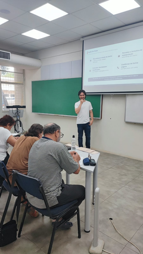
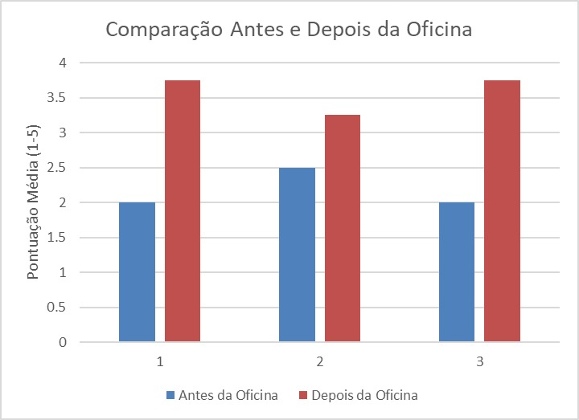

# Como não cair em Golpes Virtuais

## Equipe

| Nome                            | RA     | Curso                    |
| ------------------------------- | ------ | ------------------------ |
| Wilian Hideki Watanabe          | 195596 | Matemática Aplicada      |
| Rodrigo Banin Ferraz de Camargo | 238257 | Engenharia de Computação |
| Bernardo Gomes de Moraes        | 258372 | Engenharia Elétrica      |
| Gabriel Vioti                   | 220465 | Engenharia Elétrica      |
| Athos Estevam Zamboni           | 244674 | Engenharia Elétrica      |

## Proposta

O projeto oferece oficinas para pessoas idosas sobre golpes digitais de identidade falsificada e engenharia social, abrangendo golpes familiares e corporativos. As atividades combinam contextualização, simulações controladas, discussão com o público, boas práticas e formulários antes e depois da apresentação. A primeira aplicação ocorreu em 17 de outubro de 2026. A segunda incorporará os aprendizados dessa experiência, com maior controle do tempo e exemplos mais próximos do cotidiano dos participantes.

O foco está na articulação entre Inteligência Artificial e Cibersegurança. Slides, deepfake, fascículos e um canal de WhatsApp foram preparados para apoiar a atividade e a comunicação com os interessados. A adesão ao canal é voluntária e não condiciona a participação na oficina.

## Problema e Contexto

Golpes digitais exploram confiança, urgência e medo para induzir a vítima a transferir dinheiro ou fornecer informações. Isso pode ocorrer tanto em golpes familiares, nos quais o criminoso se passa por um filho, neto ou outra pessoa conhecida, quanto em golpes corporativos, nos quais se passa por banco, empresa ou instituição. Pessoas idosas podem estar especialmente expostas quando têm menor familiaridade com ferramentas digitais ou quando a mensagem parece vir de uma fonte conhecida.

Ferramentas de IA generativa permitem falsificar voz, rosto e mensagens com baixo custo, tornando pedidos fraudulentos mais convincentes. A motivação do grupo também vem de casos de golpes ocorridos nas famílias de seus integrantes. A oficina aproxima o tema da realidade do público, mas evita transformar participantes em alvos reais. As demonstrações serão fictícias, consentidas e não envolverão dinheiro, senhas, códigos ou dados pessoais reais.

## Público

A atividade é voltada a pessoas idosas interessadas em compreender e prevenir golpes digitais. A primeira oficina contou com quatro participantes, diante de uma previsão de dez. Essa diferença mostrou que inscrições e confirmações não devem ser tratadas como garantia de comparecimento.

O público levantou dúvidas sobre Facebook, Instagram e biometria facial. Esses temas orientarão a revisão dos exemplos para a segunda aplicação. A linguagem permanecerá acessível e sem jargões, com atenção ao ritmo de fala, à visibilidade dos materiais, ao áudio e às condições de mobilidade.

## Objetivos

### Objetivo Geral

Fortalecer a capacidade dos participantes de reconhecer golpes digitais de identidade falsificada e tomar decisões seguras antes de enviar dinheiro ou fornecer informações.

### Objetivos Específicos

- Reconhecer estratégias de engenharia social, como urgência, segredo, pressão emocional e pedidos de dados ou dinheiro.
- Compreender como deepfakes de voz e imagem podem tornar uma identidade falsa mais convincente.
- Praticar ações simples de proteção, especialmente interromper o contato e confirmar a solicitação por outro canal.
- Compartilhar boas práticas com familiares e pessoas próximas.

## Experiência

Na primeira aplicação, foram utilizados slides, formulários e duas dinâmicas, envolvendo WhatsApp e deepfake. Também foram apresentados casos reais de tentativas de golpe por WhatsApp e boleto. O público participou com perguntas e relatos, mas as conversas paralelas e as intervenções demandaram maior controle do tempo.

Na segunda aplicação, o deepfake familiar será mantido. O vídeo do contato bancário fictício será substituído por capturas de tela sequenciais, com avanço manual, para permitir pausas e discussão em cada etapa. Os slides incorporarão exemplos de Facebook e Instagram e uma explicação acessível sobre cuidados com solicitações de biometria facial e verificação de canais oficiais.

Os participantes serão convidados a identificar sinais suspeitos e explicar como reagiriam. As perguntas relacionadas à etapa serão acolhidas, enquanto relatos extensos e dúvidas fora do tema serão retomados no encerramento. As simulações continuarão fictícias e consentidas, sem transferências ou coleta de dados reais.

### Roteiro da Atividade

O roteiro abaixo orienta a segunda aplicação. A meta permanece em 90 minutos, com moderação das intervenções e registro do tempo de cada etapa. Se o encontro continuar antes do almoço, não haverá coffee break programado, sem impedir pausas necessárias ao público.

| Etapa                           | Duração | Atividade                                                                            | Participação do público                                         | Recursos                                         |
| ------------------------------- | -------: | ------------------------------------------------------------------------------------ | --------------------------------------------------------------- | ------------------------------------------------ |
| Formulário inicial              | 5 min   | Preenchimento da avaliação inicial                                                   | Responder sobre conhecimento e percepção de segurança           | Formulário digital ou impresso                   |
| Contextualização básica         | 15 min  | Apresentação de casos, incluindo exemplos cotidianos de Facebook e Instagram         | Reconhecer situações e apresentar dúvidas breves                | Slides, notebook e projetor                      |
| Preparação das dinâmicas        | 5 min   | Explicação dos cenários, regras e limites das simulações                             | Confirmar compreensão e consentimento                           | Slides e roteiro                                 |
| Golpe familiar                  | 25 min  | Exibição do deepfake e discussão moderada                                            | Identificar sinais de alerta e explicar como confirmar o pedido | Deepfake, áudio, projetor e gravação de reserva  |
| Golpe corporativo               | 25 min  | Análise de um contato bancário fictício por capturas de tela sequenciais             | Discutir cada pedido de informação e decidir como agir          | Capturas de tela, notebook e projetor            |
| Boas práticas                   | 10 min  | Sistematização das verificações, cuidados com biometria facial e retomada de dúvidas | Propor ações seguras e esclarecer dúvidas pendentes             | Slides e fascículos                              |
| Formulário final e encerramento | 5 min   | Avaliação final e entrega dos panfletos                                              | Responder ao formulário e receber o material                    | Formulário, panfletos e registro de distribuição |

**Duração total estimada:** 90 minutos.

## Planejamento das Aplicações

### Articulação com o Público e Local

- **Primeira aplicação:** realizada em 17 de outubro de 2026, na sala FE12, das 10h10 às 12h, com quatro participantes. A previsão anterior era de dez pessoas, e houve um contratempo relacionado à reserva da sala.
- **Segunda aplicação:** prevista para 21 de novembro de 2026, com horário, sala e número de participantes ainda a confirmar.
- **Mobilização:** ampliar a frequência da divulgação em grupos de idosos, comunidades ativas, no UniversIDADE e na Paróquia Santa Isabel. Participantes da primeira oficina se dispuseram a divulgar a atividade nos grupos que frequentam. Com essa mobilização, a expectativa é alcançar um público significativamente maior que o da primeira oficina, sem estabelecer uma quantidade como garantida.
- **Confirmação de presença:** registrar separadamente inscrições, confirmações e comparecimento, sem assumir que uma inscrição garante presença.

O canal de WhatsApp já foi criado. Seu uso permanece opcional. Contatos individuais não serão publicados no repositório.

### Alternativas e Contingências

A reserva e o acesso à sala deverão ser reconfirmados antes da segunda aplicação. Se a FE12 não estiver disponível, serão consideradas salas equivalentes na FEA, FEM ou em outro espaço acessível. O deepfake terá uma gravação de reserva, e as capturas de tela do cenário bancário ficarão disponíveis offline. Os dois cenários continuam previstos no roteiro, sem tratar o corporativo apenas como substituto do familiar.

## Plano de Desenvolvimento

As frentes preparadas para a primeira aplicação foram concluídas. As adaptações abaixo são propostas para a segunda oficina, sob as mesmas frentes de responsabilidade, e ainda precisam ser executadas e verificadas.

| Entregável / Resultado                   | Tarefa                                                                                           | Responsável(is)                            | Prazo                                 | Situação  |
| ---------------------------------------- | ------------------------------------------------------------------------------------------------ | ------------------------------------------ | ------------------------------------- | --------- |
| Materiais da primeira aplicação          | Preparar formulários, roteiro, deepfake, slides e apresentação                                   | Athos, Bernardo, Rodrigo, Wilian e Gabriel | Primeira aplicação                    | Concluída |
| Mobilização e avaliação atualizadas      | Reforçar divulgação, confirmar presença, organizar resultados anonimizados e revisar formulários | Athos                                      | Antes da segunda aplicação            | Planejada |
| Roteiro e dinâmica corporativa revisados | Organizar capturas de tela e momentos de perguntas dentro dos 90 minutos                         | Bernardo                                   | Antes do ensaio da segunda aplicação  | Planejada |
| Deepfake e contingência disponíveis      | Revalidar reprodução e gravação de reserva no equipamento utilizado                              | Rodrigo                                    | Antes da segunda aplicação            | Planejada |
| Slides atualizados                       | Incluir exemplos de Facebook, Instagram e cuidados com biometria facial                          | Wilian                                     | Antes do ensaio da segunda aplicação  | Planejada |
| Condução e tempo verificados             | Ensaiar moderação das intervenções e registrar duração por etapa                                 | Gabriel                                    | Antes da segunda aplicação            | Planejada |
| Logística e distribuição organizadas     | Reconfirmar sala, contar panfletos, registrar entrega autorizada e devolver sobras               | Equipe                                     | Antes e ao final da segunda aplicação | Planejada |

### Dependências Críticas

- Confirmar data, horário, reserva e acesso à sala para a segunda aplicação.
- Ampliar a divulgação e acompanhar confirmações sem pressupor comparecimento.
- Finalizar as capturas de tela e revisar os slides antes do novo ensaio.
- Revalidar equipamentos, áudio e materiais offline.
- Disponibilizar resultados anonimizados dos formulários para sustentar a análise da primeira oficina.

## Materiais e Recursos

### Materiais Desenvolvidos

Os materiais abaixo foram registrados como preparados para a primeira oficina na E3. O relato da aplicação confirma o uso dos slides, formulários e vídeos das dinâmicas. Os arquivos e links desses materiais ainda não foram disponibilizados na pasta do projeto. O gráfico de percepção subjetiva foi incluído na seção de evidências da primeira aplicação.

- Formulários de inscrição, conhecimento prévio, avaliação final e feedback.
- Roteiro completo da oficina e plano de contingência.
- Deepfake autorizado de um integrante do grupo e gravação de reserva.
- Slides e lista de boas práticas.
- Fascículos sobre prevenção de golpes digitais.
- Mensagens de divulgação e conteúdos para o grupo de WhatsApp.

### Materiais a Atualizar para a Segunda Aplicação

- Capturas de tela sequenciais do contato bancário fictício em substituição ao vídeo dessa dinâmica.
- Slides com situações de Facebook, Instagram e cuidados com biometria facial.
- Roteiro com moderação das falas e controle do tempo por etapa.
- Resultados anonimizados dos formulários, com identificação das perguntas e número de respostas válidas, para complementar o gráfico de percepção subjetiva já disponível.
- Registro de quantidade de panfletos levados, entregues, restantes e devolvidos.

### Recursos para a Aplicação

- Notebook com o software e os arquivos da demonstração.
- Projetor, tela e sistema de áudio.
- Acesso à Internet e adaptadores necessários.
- Celular para apoio às dinâmicas, caso seja necessário.
- Sala com assentos, visibilidade, acústica e acessibilidade adequadas.
- Versão impressa do formulário, caso o preenchimento digital não seja viável.

### Testes Realizados

- O deepfake foi reproduzido no notebook, com voz e imagem verificadas.
- A ligação simulada e a gravação de contingência foram testadas.
- O notebook, os adaptadores, o projetor, o áudio e a Internet foram testados na sala FE12.
- Os formulários foram validados em celular e computador, com alternativa impressa disponível.
- O roteiro completo de 90 minutos foi ensaiado, incluindo transições, perguntas, velocidade de fala e ênfase.
- A contingência sem Internet foi executada e validada.

### Testes para a Segunda Aplicação

- Reconfirmar a reserva e testar o acesso à sala e os equipamentos.
- Ensaiar o avanço manual das capturas de tela, verificando clareza e pausas para discussão.
- Revisar a compreensão dos exemplos de redes sociais e biometria facial.
- Ensaiar os 90 minutos com perguntas, transições, preenchimento dos formulários e entrega dos panfletos.
- Verificar os arquivos offline, a reprodução do deepfake e o registro de distribuição dos materiais.

## Avaliação

### Indicadores de Sucesso

| Objetivo                                        | Indicador / Evidência                                                                                                                        |
| ----------------------------------------------- | -------------------------------------------------------------------------------------------------------------------------------------------- |
| Reconhecer estratégias de engenharia social     | Participantes identificam sinais como urgência, segredo, pressão emocional e pedidos de dinheiro ou dados na simulação e no formulário final |
| Compreender o risco de identidades falsificadas | Participantes explicam que voz, rosto ou nome conhecidos não bastam para confirmar a identidade                                              |
| Praticar ações de proteção                      | Participantes propõem interromper o contato, não fornecer informações e confirmar o pedido por outro canal                                   |
| Compartilhar boas práticas                      | Participantes indicam ao menos uma orientação concreta que levariam a familiares ou pessoas próximas                                         |
| Ampliar o alcance da oficina                    | Registro separado de inscrições, confirmações e presenças, comparado aos quatro participantes da primeira aplicação                          |
| Melhorar o ritmo da atividade                   | Duração total e por etapa, dúvidas retomadas no encerramento e acompanhamento das capturas de tela                                           |

### Coleta de Evidências e Feedback

Na primeira oficina, os formulários foram distribuídos após a apresentação inicial e preenchidos rapidamente, segundo o relato da equipe. O gráfico de comparação da percepção subjetiva antes e depois está disponível na seção de evidências da primeira aplicação. As respostas individuais anonimizadas, os enunciados das perguntas e o número de respostas válidas ainda não foram disponibilizados, o que limita a interpretação dos resultados.

Na segunda aplicação, serão mantidos os formulários inicial e final e a observação das decisões propostas pelo público. Também serão registrados comparecimento, duração de cada etapa, dúvidas recorrentes e quantidades de panfletos. A percepção subjetiva será analisada separadamente do conhecimento demonstrado. Resultados serão publicados apenas de forma agregada, sem respostas identificáveis.

O registro fotográfico da entrega de panfletos dependerá de autorização dos participantes. Sem autorização, serão registrados apenas os materiais, sem identificação de pessoas. Os exemplares restantes serão contados e devolvidos.

## Riscos e Desafios

| Risco / Desafio                                                      | Possível impacto                                           | Estratégia                                                                                               |
| -------------------------------------------------------------------- | ---------------------------------------------------------- | -------------------------------------------------------------------------------------------------------- |
| Falha de áudio, projeção ou reprodução                               | Interrupção da dinâmica                                    | Revalidar equipamentos e manter gravação e capturas de tela offline                                      |
| Conversas paralelas e intervenções extensas                          | Repetir a duração de 110 minutos da primeira aplicação     | Moderar falas, registrar tempos e retomar dúvidas extensas no encerramento                               |
| Simulação causar constrangimento ou relembrar experiências negativas | Redução da confiança e do engajamento                      | Explicar previamente, obter consentimento, permitir não participar e realizar debriefing imediato        |
| Indisponibilidade imprevista da sala                                 | Necessidade de mudar o local da segunda aplicação          | Reconfirmar reserva e acesso e manter uma alternativa acessível                                          |
| Coleta excessiva de dados no formulário ou no WhatsApp               | Exposição da privacidade dos participantes                 | Coletar apenas o necessário, informar a finalidade, restringir a administração e permitir saída do grupo |
| Barreiras de visão, audição ou mobilidade                            | Participação desigual                                      | Levantar necessidades no formulário, verificar o espaço e oferecer áudio, texto e formulário impresso    |
| Baixo comparecimento apesar das inscrições                           | Alcance menor que o planejado                              | Divulgar em comunidades ativas, confirmar presença e registrar comparecimento real                       |
| Registro de imagens sem autorização                                  | Exposição indevida dos participantes                       | Obter autorização antes de fotografar e publicar, ou registrar somente os materiais                      |
| Sobras de panfletos sem controle                                     | Perda de materiais e ausência de evidência de distribuição | Contar exemplares levados, entregues, restantes e devolvidos                                             |

## Primeira Aplicação: Registro e Análise

### Contexto da Aplicação

- **Data:** 17 de outubro de 2026.
- **Local/contexto:** sala FE12, com contratempo relacionado à reserva.
- **Público atendido:** pessoas idosas interessadas em prevenção de golpes digitais.
- **Número de participantes:** quatro pessoas, diante da confirmação de dez.
- **Duração efetiva:** 110 minutos, das 10h10 às 12h. O roteiro previa 90 minutos. 

### O que Aconteceu e o que Aprendemos

A equipe chegou antecipadamente para organizar a sala, os materiais e os equipamentos. Apesar dessa preparação, houve um contratempo com a reserva, indicando a necessidade de reconfirmar o espaço e o acesso antes do próximo encontro.

Após uma breve apresentação, os formulários foram distribuídos e preenchidos rapidamente. Bernardo conduziu a apresentação oral, com participações pontuais de Wilian. Foram utilizados slides, as dinâmicas de WhatsApp e deepfake e dois casos reais de tentativa de golpe, envolvendo WhatsApp e boleto. Os vídeos funcionaram, segundo o relato da equipe.

Houve interação frequente e esclarecimento de dúvidas durante a exposição e no encerramento. Esse envolvimento aproximou a atividade das experiências do público, mas as conversas paralelas e intervenções também exigiram mais tempo. A oficina ultrapassou em 20 minutos o roteiro previsto. Não houve medição por etapa que permita atribuir todo o atraso a uma causa específica.

As dúvidas sobre Facebook, Instagram e biometria facial mostraram a importância de incorporar situações mais próximas do cotidiano dos participantes. A equipe também identificou que, na dinâmica do golpe bancário, capturas de tela da conversa de WhatsApp são mais ilustrativos e permitem controlar melhor o ritmo do cenário bancário do que um vídeo contínuo.

O comparecimento de quatro pessoas, em vez das dez previstas, reforçou a necessidade de divulgar em comunidades mais ativas e não depender das inscrições como garantia de presença. Participantes se dispuseram a divulgar a oficina em outros grupos de atividades em que participam.

### Evidências e Feedback

As evidências disponíveis neste registro incluem os horários, o número de presentes, as observações relatadas pela equipe, uma fotografia da atividade e o gráfico de autoavaliação. Foram registradas perguntas frequentes, dúvidas esclarecidas e interesse por redes sociais e biometria facial. A impressão dos organizadores foi positiva quanto à utilidade e à receptividade da oficina. Essa impressão não equivale a uma medida objetiva de aprendizagem.

[Ver foto em resolução original](evidencias/primeira-oficina-apresentacao.png)

Registro da primeira aplicação durante a apresentação de boas práticas de prevenção a golpes. A fotografia documenta a realização da atividade, sem comprovar, por si só, resultados de aprendizagem. A autorização das pessoas retratadas deverá ser confirmada antes da publicação da imagem.

O gráfico apresenta as médias da autoavaliação antes e depois da oficina, em uma escala de 1 a 5. As barras azuis representam o momento inicial e as vermelhas, o momento final. Os três itens apresentam médias maiores após a atividade. Pela leitura visual, os itens 1 e 3 tiveram avanços semelhantes e maiores que o item 2.

Essas médias são a base para calcular o **ganho normalizado de Hake**, que relaciona o avanço observado ao avanço máximo ainda possível a partir da pontuação inicial. As barras mostram as médias, não o ganho normalizado diretamente. Adaptando a definição de [Hake (2002)](https://ecologyandsociety.org/vol5/iss2/art28/) ao máximo de 5 pontos do formulário, o cálculo por item é:

$$
g = \frac{\bar{x}_{\text{depois}} - \bar{x}_{\text{antes}}}{5 - \bar{x}_{\text{antes}}}
$$

O numerador representa a diferença entre as médias final e inicial. O denominador representa quanto a média inicial ainda poderia crescer até atingir 5. Assim, o índice expressa a fração do avanço possível que foi alcançada, e não o aumento percentual em relação à pontuação inicial.

Como exemplo ilustrativo, se uma média passasse de 2 para 3,5, o ganho seria de 1,5 ponto entre os 3 pontos ainda possíveis, resultando em `g = 0,5`. Isso corresponderia a 50% do avanço possível, não a 50% de aumento no conhecimento. Esse exemplo explica o cálculo e não substitui os valores exatos dos formulários.

Um ganho igual a zero indica ausência de mudança na média, um ganho igual a um indica que a média final atingiu o máximo e um ganho negativo indica redução. Se a média inicial já for 5, o denominador será zero e o índice não estará definido. O ganho calculado sobre as médias do grupo também não deve ser confundido com a média dos ganhos individuais.

Nesta oficina, a aplicação do índice à escala de autoavaliação é descritiva. O gráfico sugere uma melhora na percepção dos respondentes, mas nem essa melhora nem o ganho normalizado demonstram, isoladamente, aprendizagem objetiva, mudança de comportamento ou efeito causado exclusivamente pela oficina. Os índices definitivos por item deverão ser calculados com as médias exatas dos formulários, em vez de estimativas das alturas das barras.

A imagem identifica os itens apenas como 1, 2 e 3, sem apresentar os enunciados, o número de respostas válidas ou a correspondência entre respondentes antes e depois. Por isso, não são atribuídos significados específicos a cada item, nem se presume que os quatro participantes responderam a todas as perguntas. As respostas anonimizadas e o detalhamento do formulário ainda precisam ser disponibilizados. O público reduzido também limita a generalização das conclusões.

## Plano de Aprimoramento para a Segunda Aplicação

| Evidência ou dificuldade observada                         | Ajuste proposto                                                                                  | Resultado esperado                                                  |
| ---------------------------------------------------------- | ------------------------------------------------------------------------------------------------ | ------------------------------------------------------------------- |
| Comparecimento de quatro pessoas diante da previsão de dez | Divulgar em comunidades ativas e em outras atividades do público, com confirmação próxima à data | Ampliar o comparecimento e distinguir inscrição de presença efetiva |
| Contratempo relacionado à reserva                          | Reconfirmar sala, acesso e infraestrutura antes do encontro                                      | Evitar dificuldades na preparação e no início                       |
| Conversas paralelas e duração de 110 minutos               | Moderar intervenções e controlar o tempo por etapa, retomando dúvidas extensas ao final          | Preservar a participação dentro do roteiro de 90 minutos            |
| Vídeo da dinâmica bancária com pouco controle de ritmo     | Substituir o vídeo por capturas de tela sequenciais                                              | Permitir pausas e discussão conforme a compreensão do público       |
| Dúvidas sobre Facebook e Instagram                         | Incluir situações dessas redes sociais nos exemplos                                              | Aproximar o conteúdo do cotidiano dos participantes                 |
| Dúvidas sobre biometria facial                             | Explicar cuidados com solicitações suspeitas e confirmação de canais oficiais                    | Apoiar decisões seguras sem tratar toda solicitação como fraude     |
| Encontro realizado antes do almoço                         | Não prever coffee break se o horário matutino for mantido, preservando pausas necessárias        | Evitar prolongar o encontro e respeitar o horário do público        |
| Necessidade de evidenciar a distribuição dos panfletos     | Registrar entrega com autorização, contar sobras e devolver os exemplares restantes              | Documentar a distribuição e prestar contas dos materiais            |

### Preparação da Segunda Aplicação

- **Situação da segunda aplicação:** prevista para 21 de novembro de 2026, com horário e sala ainda a confirmar. A divulgação mais frequente nos grupos de idosos e na paróquia busca alcançar um público significativamente maior que os quatro participantes da primeira oficina. O número de participantes ainda não está confirmado. Os materiais da primeira oficina serão reaproveitados com as adaptações descritas.
- **Pendências prioritárias:** confirmar logística e público, ampliar divulgação, preparar capturas de tela, atualizar slides, ensaiar o roteiro e disponibilizar materiais e resultados anonimizados. Organizar a contagem dos panfletos, a devolução das sobras e a autorização para imagens.
- **Como verificaremos as melhorias:** comparar comparecimento, registrar tempo por etapa, observar decisões nos novos exemplos, analisar respostas iniciais e finais e conferir o balanço dos panfletos. A E4 deverá estar concluída antes da segunda aplicação, com prazo informado pelo grupo de 12 de novembro de 2026.

## Referências

- CERT.br. *Cartilha de Segurança para Internet*. Disponível em: [https://cartilha.cert.br/](https://cartilha.cert.br/).
- Fallis, D. (2020). *The Epistemic Threat of Deepfakes*. Philosophy &amp; Technology.
- SaferNet Brasil. Materiais educativos e canais de orientação sobre segurança e cidadania digital. Disponível em: [https://www.safernet.org.br/](https://www.safernet.org.br/).
- NASA. *Work Breakdown Structure (WBS) Handbook*. Disponível em: [https://www.nasa.gov/wp-content/uploads/2023/08/nasa-work-breakdown-structure-handbook.pdf](https://www.nasa.gov/wp-content/uploads/2023/08/nasa-work-breakdown-structure-handbook.pdf).
- Hake, R. (2002). *Lessons from the Physics Education Reform Effort*. Conservation Ecology, 5(2), 28. Disponível em: [https://ecologyandsociety.org/vol5/iss2/art28/](https://ecologyandsociety.org/vol5/iss2/art28/).