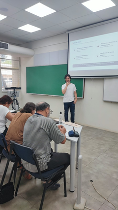
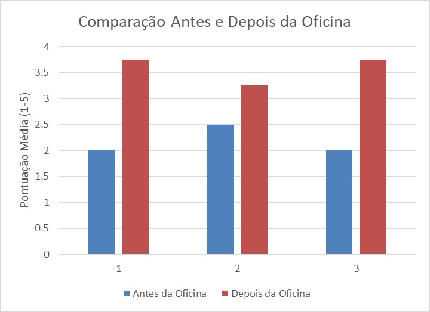
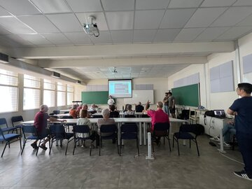
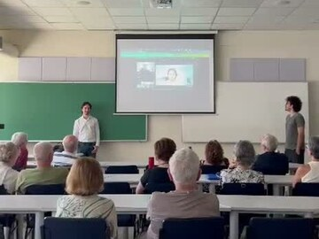
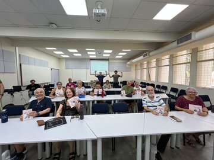
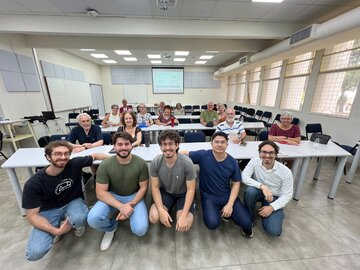
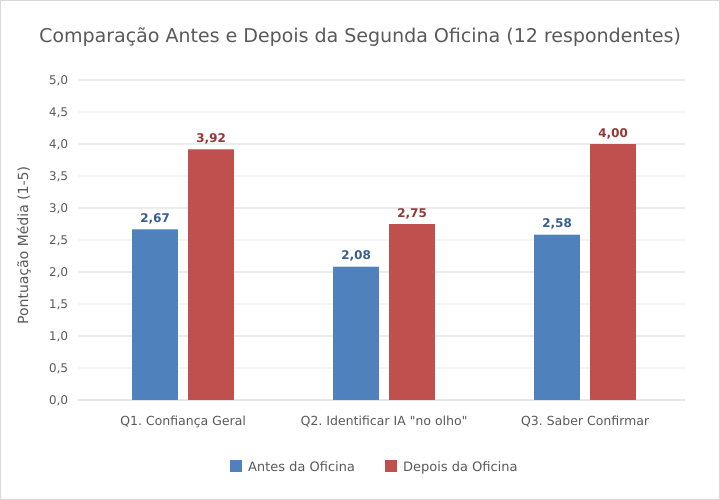

# Como não cair em Golpes Virtuais

## Equipe

| Nome                            | RA     | Curso                    |
| ------------------------------- | ------ | ------------------------ |
| Wilian Hideki Watanabe          | 195596 | Matemática Aplicada      |
| Rodrigo Banin Ferraz de Camargo | 238257 | Engenharia de Computação |
| Bernardo Gomes de Moraes        | 258372 | Engenharia Elétrica      |
| Gabriel Vioti                   | 220465 | Engenharia Elétrica      |
| Athos Estevam Zamboni           | 244674 | Engenharia Elétrica      |

## Proposta

O projeto consiste em uma oficina presencial de educação digital voltada a pessoas idosas (60+) sobre prevenção a golpes virtuais de identidade falsificada e engenharia social, articulando Inteligência Artificial e Cibersegurança. A atividade aborda tanto golpes familiares, nos quais o golpista imita um parente próximo com apoio de áudio ou vídeo sintético (deepfake), quanto golpes corporativos, nos quais simula o atendimento de segurança de um banco ou instituição.

A oficina combina contextualização de situações cotidianas, duas simulações controladas e consentidas, discussão moderada com o público, sistematização de boas práticas, avaliação antes e depois do encontro e distribuição de fascículos impressos do CERT.br. Foram realizadas duas aplicações presenciais na sala FE12 da Faculdade de Engenharia Elétrica e de Computação (FEEC) da Unicamp: a primeira em 17 de outubro de 2026, com 4 participantes, e a segunda em 21 de novembro de 2026, com 13 participantes. Um canal opcional de WhatsApp também foi disponibilizado para envio voluntário de avisos e materiais complementares, sem condicionar a participação presencial.

## Problema e Contexto

Golpes digitais exploram confiança, urgência, medo e respeito à autoridade para induzir a vítima a transferir dinheiro ou fornecer dados sensíveis. No contexto brasileiro, essas abordagens ocorrem com frequência por WhatsApp, redes sociais, ligações telefônicas e boletos falsos. Pessoas idosas estão particularmente expostas quando enfrentam barreiras de familiaridade com interfaces digitais ou quando a mensagem aparenta vir de um familiar ou de uma central bancária legítima.

A popularização de ferramentas de IA generativa reduziu o custo para clonar vozes, manipular rostos em vídeo e redigir mensagens convincentes, enfraquecendo a ideia de que basta reconhecer a voz ou a foto de quem fala para confiar no contato. A motivação do grupo surgiu de relatos reais ocorridos nas próprias famílias dos integrantes. Por envolver um tema sensível, toda a concepção pedagógica adotou simulações fictícias, transparentes e previamente anunciadas, sem expor participantes a constrangimento nem solicitar senhas, códigos, cartões ou transferências reais.

## Público

A atividade destina-se a pessoas com 60 anos ou mais interessadas em usar celular, aplicativos de mensagens, redes sociais e serviços bancários digitais com maior segurança. Não é exigido conhecimento técnico prévio em computação ou Inteligência Artificial, bastando familiaridade básica com o uso cotidiano de telefone ou WhatsApp.

Para reaplicação, recomenda-se organizar turmas de **10 a 20 participantes**, faixa que preserva o acolhimento individual e viabiliza o debate guiado dentro de 90 minutos. A linguagem deve permanecer direta e livre de jargões, com slides de alto contraste, formulários impressos em fonte legível, bom volume de áudio e sala acessível para pessoas com mobilidade reduzida.

## Objetivos

### Objetivo Geral

Fortalecer a capacidade de pessoas idosas de reconhecer estratégias de engenharia social e falsificação de identidade mediadas por IA, adotando procedimentos seguros de verificação antes de fornecer informações ou realizar transferências.

### Objetivos Específicos

- Reconhecer sinais clássicos de manipulação em golpes digitais, como urgência artificial, pedido de segredo, pressão emocional, autoridade simulada e solicitação de dados ou valores.
- Compreender de forma prática que vozes, imagens e perfis podem ser falsificados com ferramentas de IA generativa, não servindo isoladamente como prova de identidade.
- Praticar condutas concretas de proteção, em especial interromper o contato recebido, desconfiar de pedidos fora dos canais oficiais e confirmar a solicitação por um meio independente.
- Estimular o compartilhamento das orientações e dos fascículos educativos com familiares, amigos e grupos comunitários.

## Experiência

Na versão final consolidada na segunda aplicação, a oficina é conduzida em 90 minutos, combinando exposição dialogada curta e análise participativa de dois cenários simulados:

1. **Contextualização próxima da rotina:** levantamento inicial dos golpes que já apareceram no dia a dia da turma (mensagens de falso banco, falso familiar, links por SMS ou WhatsApp, boletos, anúncios falsos em Facebook e Instagram), destacando os gatilhos psicológicos comuns.
2. **Cenário familiar com deepfake:** demonstração autorizada de deepfake com imagem e voz de um integrante do grupo para ilustrar como a IA generativa pode imitar alguém próximo. A discussão enfatiza que o participante não precisa virar especialista técnico em detectar falhas visuais no vídeo, pois a defesa mais confiável é encerrar a chamada e telefonar para o número antigo já conhecido do familiar.
3. **Cenário corporativo com capturas de tela sequenciais:** análise pausada, tela a tela, de uma conversa de WhatsApp com a falsa central de segurança do fictício *Banco Aurora*. Em vez de exibir um vídeo corrido, o facilitador avança manualmente cinco capturas de tela, parando em cada etapa para que o público aponte como o golpista constrói confiança antes de pedir número, validade e código de segurança do cartão.
4. **Sistematização, cuidados com biometria facial e material de consulta:** fechamento com regras práticas de confirmação, orientações sobre solicitações suspeitas de reconhecimento facial (que jamais devem ser feitas por links externos) e entrega de dois fascículos impressos do CERT.br após o preenchimento do formulário final.

Durante toda a atividade, um integrante da equipe acompanha o tempo de cada bloco. Perguntas diretamente ligadas à etapa em curso são respondidas no momento, enquanto relatos pessoais mais longos e dúvidas complementares são acolhidos no bloco final para manter o ritmo do encontro.

### Roteiro da Atividade

| Etapa                           | Duração | Atividade e condução do facilitador                                                   | Participação esperada do público                                | Recursos utilizados                                     |
| ------------------------------- | ------: | ------------------------------------------------------------------------------------- | --------------------------------------------------------------- | ------------------------------------------------------- |
| Formulário inicial              | 5 min   | Recepção, entrega de canetas e aplicação do questionário pré-oficina impresso         | Responder individualmente aos itens iniciais (`Q1` a `Q6`)      | Formulários impressos e canetas                         |
| Contextualização básica         | 15 min  | Exposição dialogada de casos cotidianos em WhatsApp, boleto, Facebook e Instagram     | Identificar situações conhecidas e comentar sinais iniciais     | Slides, notebook e projetor                             |
| Preparação das dinâmicas        | 5 min   | Explicação das regras, do caráter fictício dos cenários e confirmação de consentimento | Confirmar compreensão do formato seguro das simulações          | Slides e roteiro do facilitador                         |
| Golpe familiar (deepfake)       | 25 min  | Demonstração do deepfake autorizado e debate sobre pedidos urgentes de familiares     | Apontar sinais de alerta e propor confirmação por outro canal   | Demonstração de deepfake, áudio, projetor e vídeo local |
| Golpe corporativo (falso banco) | 25 min  | Análise guiada das 5 capturas sequenciais da conversa com o fictício Banco Aurora     | Avaliar cada mensagem e indicar quando interromper o contato    | Capturas sequenciais nos slides, notebook e projetor    |
| Boas práticas e dúvidas         | 10 min  | Síntese das regras de verificação, cuidados com biometria facial e dúvidas pendentes  | Revisar condutas seguras e esclarecer dúvidas finais            | Slides de fechamento                                    |
| Formulário final e encerramento | 5 min   | Aplicação do questionário pós-oficina (`Q1` a `Q8`) seguida da entrega dos fascículos | Preencher e entregar a avaliação antes de receber os fascículos | Formulários impressos e fascículos do CERT.br           |

**Duração total recomendada:** 90 minutos (sem intervalo de coffee break quando realizada no período da manhã, preservando pausas individuais sempre que necessário).

## Materiais e Recursos

### Materiais para Reutilização

A tabela abaixo reúne os materiais disponíveis na pasta do projeto e em fontes abertas oficiais para que outra equipe compreenda a proposta e consiga reaplicar a oficina, indicando também as dependências e limitações dos recursos externos.

| Material | Finalidade e modo de uso | Arquivo ou link | Preparação e dependências |
| --- | --- | --- | --- |
| Roteiro completo do facilitador | Orienta preparação da sala, regras éticas, falas principais, perguntas de mediação em cada tela e controle dos 90 minutos | [`materiais/roteiro-facilitador.md`](materiais/roteiro-facilitador.md) | Ler em equipe antes do ensaio e definir um responsável pelo controle do relógio |
| Capturas sequenciais da dinâmica corporativa (Banco Aurora) | Cinco telas em ordem cronológica para conduzir pausadamente a simulação de falso atendimento bancário na Etapa 5 | [`materiais/dinamica-banco-aurora/`](materiais/dinamica-banco-aurora/) | Inserir em slides ou abrir localmente em ordem numérica (`01` a `05`), sem depender de Internet |
| Protocolo e estrutura do instrumento de avaliação | Documenta os itens pré e pós-oficina (`Q1` a `Q8`), escalas, gabaritos dos cenários e cálculo das métricas | [`materiais/instrumento-avaliacao.md`](materiais/instrumento-avaliacao.md) | Diagramar versão impressa em fonte grande (mínimo 14 pt) e codificar folhas como `P1..Pn` |
| Planilha modelo de consolidação e dados anonimizados | Demonstra a tabulação pareada e as fórmulas automáticas de média, desvio-padrão e evolução entre pré e pós-oficina | [`evidencias/metricas-segunda-oficina.xlsx`](evidencias/metricas-segunda-oficina.xlsx) e [`evidencias/metricas-segunda-oficina.csv`](evidencias/metricas-segunda-oficina.csv) | Duplicar a planilha limpando as colunas `P1..Pn` para registrar uma nova turma |
| Arte de divulgação da oficina | Modelo visual de convite voltado ao público 60+ para divulgação em grupos comunitários, paróquias e programas universitários | [`materiais/cartaz-divulgacao-segunda-oficina.jpg`](materiais/cartaz-divulgacao-segunda-oficina.jpg) | Adaptar data, local e link de inscrição conforme a oferta (contato individual omitido na versão pública) |
| Fascículos educativos impressos do CERT.br | Material de apoio entregue no encerramento (*Golpes: Não se Deixe Enganar* e *Golpes: Caiu? Veja o que Fazer*) para consulta em casa e conversa com familiares | [Fascículos e Cartilha CERT.br](https://cartilha.cert.br/fasciculos/) | Baixar gratuitamente os PDFs no site do CERT.br ou solicitar exemplares impressos com antecedência |
| Apresentação em slides e demonstração de deepfake | Apoio visual das etapas expositivas e demonstração prática de falsificação de imagem e voz na Etapa 4 | Registro visual nas evidências ([dinâmica bancária](evidencias/segunda-oficina-dinamica-banco.jpg), [demonstração de deepfake](evidencias/segunda-oficina-deepfake-demonstracao.jpg) e [vídeo resumo no Google Drive](https://drive.google.com/file/d/1dfRIyruGuDMVsfsDrk-zI-Y1a7dlsvIa/view?usp=sharing)) | O arquivo bruto do deepfake usa imagem e voz de um integrante e não foi publicado isoladamente para evitar reutilização indevida de dados biométricos. Outra equipe deve gravar demonstração própria com consentimento expresso de um voluntário da equipe e manter cópia em vídeo offline |

### Recursos de Infraestrutura e Alternativas sem Internet

- **Equipamentos em sala:** computador portátil, projetor com boa luminosidade, cabo ou adaptador compatível e caixa de som testada previamente para reprodução clara de vozes.
- **Materiais físicos:** cópias impressas dos formulários inicial e final, canetas esferográficas (ao menos uma por participante) e exemplares impressos dos fascículos.
- **Operação offline:** todas as capturas do cenário corporativo, os slides e um vídeo gravado da demonstração de deepfake devem permanecer salvos localmente no notebook. Dessa forma, oscilações de Wi-Fi ou de processamento em tempo real não interrompem nenhuma etapa da oficina.

## Avaliação

### Indicadores e Instrumentos

A avaliação da atividade combina **instrumento estruturado pareado** (aplicado no início e ao final do encontro) e **observação direta das discussões** durante as duas simulações:

| Objetivo específico | Indicador avaliado | Instrumento e momento |
| --- | --- | --- |
| Reconhecer estratégias de engenharia social | Identificação verbal de urgência, segredo, falsa autoridade e pedido de dados nas simulações, além de acerto nos cenários `Q4` a `Q6` | Discussão guiada nas Etapas 4 e 5 + questionário pré e pós-oficina |
| Compreender riscos de identidades falsificadas por IA | Percepção sobre os limites de identificar IA apenas "no olho" (`Q2`) e reconhecimento verbal de que voz ou vídeo isolados não confirmam identidade | Etapa 4 (deepfake) + item `Q2` pré e pós-oficina + avaliação da dinâmica (`Q7`) |
| Praticar ações seguras de proteção | Aumento na clareza sobre como confirmar pedidos (`Q3`), na confiança geral (`Q1`) e escolha da verificação por outro canal nos cenários práticos (`Q4` a `Q6`) | Questionário pré e pós-oficina + decisões propostas na simulação do Banco Aurora (`Q8`) |
| Compartilhar boas práticas | Recebimento ativo dos fascículos do CERT.br e manifestações espontâneas de repasse a familiares e grupos próximos | Observação no encerramento e registro da entrega dos materiais |

### Critérios de Interpretação

- **Separação entre percepção subjetiva e desempenho prático:** os itens `Q1` a `Q3` medem percepção subjetiva de confiança e clareza em escala de 1 a 5, ao passo que `Q4` a `Q6` verificam a decisão diante de situações concretas e `Q7` e `Q8` medem a utilidade percebida das dinâmicas. Satisfação ou ganho de confiança não são tratados isoladamente como prova automática de aprendizagem.
- **Ganho normalizado sobre médias subjetivas:** nos itens de escala Likert (`Q1` a `Q3`), calcula-se complementarmente o ganho normalizado de Hake (`g`) adaptado ao teto de 5 pontos como medida descritiva da fração do avanço possível obtida pelos respondentes.

$$
g = \frac{\bar{x}_{\text{depois}} - \bar{x}_{\text{antes}}}{5 - \bar{x}_{\text{antes}}}
$$

## Riscos e Desafios

| Risco ou desafio | Impacto observado ou potencial | Estratégia consolidada |
| --- | --- | --- |
| Baixo comparecimento em relação às inscrições | Redução do alcance presencial, como ocorreu na primeira oficina (4 presentes de 10 previstos) | Ampliar divulgação antecipada em comunidades ativas, paróquias e grupos 60+, tratando inscrição separadamente da presença efetiva |
| Contratempos de reserva e infraestrutura | Atraso na montagem da sala, observado na primeira aplicação | Reconfirmar reserva e acesso à sala na véspera e chegar com antecedência para testar áudio e projeção |
| Conversas paralelas e relatos longos durante os slides | Extrapolação do tempo previsto de 90 minutos (110 minutos na primeira oficina) | Adotar capturas sequenciais com avanço manual e moderar intervenções, reservando relatos extensos para o bloco final |
| Falha de Internet ou de execução ao vivo do deepfake | Interrupção da demonstração central de IA | Manter vídeo pré-gravado da demonstração e todas as telas da simulação bancária armazenados localmente |
| Desconforto emocional ao relembrar golpes sofridos | Constrangimento ou retração de participantes | Anunciar previamente o caráter fictício das dinâmicas, não expor ninguém individualmente e manter acolhimento respeitoso |
| Barreiras de visão, audição ou uso de celular no formulário | Baixa adesão à avaliação ou preenchimento incompleto | Priorizar formulário impresso em fonte legível, entregar canetas e aplicar a avaliação pós-oficina antes da dispersão final |
| Exposição de dados pessoais ou imagens não autorizadas | Violação de privacidade dos participantes ou da equipe | Anonimizar respostas (`P1..Pn`), não divulgar contatos pessoais no repositório e publicar fotografias somente com autorização |

## Primeira Aplicação: Registro e Análise

### Contexto da Aplicação

- **Data:** 17 de outubro de 2026.
- **Local e contexto:** sala FE12 da FEEC na Unicamp, com contratempo inicial relacionado à reserva.
- **Público atendido:** pessoas idosas interessadas em prevenção de golpes digitais.
- **Número de participantes:** 4 pessoas presentes, diante de uma previsão anterior de 10 confirmados.
- **Duração efetiva:** 110 minutos, das 10h10 às 12h00, superando em 20 minutos o planejamento de 90 minutos.

### O que Aconteceu e o que Aprendemos

A equipe chegou antecipadamente para preparar sala, materiais e equipamentos, contornando um imprevisto inicial na reserva do espaço. Após breve acolhida e preenchimento rápido do formulário inicial, Bernardo conduziu a apresentação oral com intervenções pontuais de Wilian. Foram empregados slides, as dinâmicas de WhatsApp e deepfake e dois relatos reais de tentativas de golpe por WhatsApp e boleto. Os vídeos funcionaram adequadamente no equipamento da sala.

Houve participação constante por meio de relatos e perguntas, o que aproximou a oficina da vivência dos presentes, mas alongou a atividade para 110 minutos sem cronometragem separada por etapa. Surgiram dúvidas recorrentes sobre golpes em Facebook e Instagram e sobre pedidos de biometria facial. Além disso, a equipe percebeu que exibir o golpe bancário em formato de vídeo contínuo dificultava pausar no momento exato de cada decisão, motivando a substituição por capturas de tela sequenciais na segunda oferta. O comparecimento reduzido (4 de 10 previstos) também evidenciou a necessidade de diversificar os canais de divulgação em grupos ativos de idosos.

### Evidências e Feedback da Primeira Aplicação

[Ver foto em resolução original](evidencias/primeira-oficina-apresentacao.png)

O registro fotográfico acima documenta a condução da etapa de boas práticas na sala FE12, com autorização confirmada para publicação.

O gráfico da primeira aplicação apresenta as médias de autoavaliação antes (azul) e depois (vermelho) nos três itens subjetivos em escala de 1 a 5 (`1: Confiança geral`, `2: Identificar IA no olho` e `3: Saber confirmar`), todos com elevação visual das médias após o encontro e avanços mais acentuados nos itens 1 e 3 do que no item 2. Conforme a formulação de [Hake (2002)](https://ecologyandsociety.org/vol5/iss2/art28/) adaptada ao máximo de 5 pontos:

$$
g = \frac{\bar{x}_{\text{depois}} - \bar{x}_{\text{antes}}}{5 - \bar{x}_{\text{antes}}}
$$

Na primeira aplicação, apenas a imagem consolidada do gráfico foi preservada pela equipe, sem arquivamento separado da planilha bruta individual daquela data. Por rigor metodológico, não foram estimados retrospectivamente os valores numéricos exatos nem o denominador de respostas válidas da primeira turma a partir da leitura visual das barras, falha documental que foi integralmente corrigida na segunda aplicação.

## Segunda Aplicação: Registro e Resultados

- **Data:** 21 de novembro de 2026 (sábado).
- **Local e contexto:** sala FE12 da FEEC na Unicamp, divulgada para o horário das 10h00 às 11h30.
- **Público atendido:** pessoas idosas (60+) da comunidade externa e de grupos de convivência mobilizados pela equipe e por participantes da edição anterior.
- **Número de participantes:** 13 participantes presentes, dos quais 12 responderam aos formulários pré e pós-oficina (`n = 12` respondentes válidos, pois uma pessoa não preencheu o formulário).
- **Duração efetiva:** conduzida dentro da janela matutina planejada de 90 minutos (10h00 às 11h30), sem cronometragem individualizada por etapa registrada em planilha.

### Relato da Segunda Aplicação e Ajustes Realizados

Para a segunda oferta, a divulgação foi reforçada com antecedência por meio de cartaz próprio voltado ao público 60+ ([`materiais/cartaz-divulgacao-segunda-oficina.jpg`](materiais/cartaz-divulgacao-segunda-oficina.jpg)), compartilhado em comunidades ativas, paróquias e redes de participantes da primeira turma. O comparecimento mais que triplicou em relação à primeira aplicação, alcançando 13 idosos presentes e reserva regularizada sem intercorrências na sala FE12.

Na condução pedagógica, todos os integrantes da equipe atuaram presencialmente no acolhimento, operação técnica, mediação e aplicação dos instrumentos. Os principais ajustes planejados na E4 foram efetivamente executados:

- **Substituição do vídeo bancário por capturas sequenciais:** a conversa com o fictício *Banco Aurora* foi projetada passo a passo nos slides, permitindo pausar a cada mensagem para que os participantes levantassem a mão, apontassem a estratégia de falsa autoridade e decidissem como agir antes de revelar a tela seguinte.
- **Demonstração de deepfake e discussão sobre redes sociais e biometria:** a demonstração de falsificação por IA foi exibida no projetor e articulada aos casos cotidianos levantados no início da oficina, reforçando a orientação de não realizar biometria facial por links externos e de confirmar pedidos urgentes por outro canal.
- **Aplicação estruturada dos formulários impressos e entrega de fascículos:** os questionários inicial e final foram preenchidos em papel nas mesas com apoio da equipe antes da dispersão, obtendo 12 respostas pareadas válidas entre os 13 presentes (`12 de 13`, correspondendo a 92,3% de adesão, pois uma pessoa não preencheu o formulário). No encerramento, os participantes receberam exemplares impressos dos fascículos *Golpes: Não se Deixe Enganar* e *Golpes: Caiu? Veja o que Fazer*, do CERT.br. Não foi mantida planilha formal de contagem das sobras de fascículos, registrando-se a entrega efetiva em sala pelas evidências fotográficas autorizadas abaixo.

| Dinâmica corporativa em capturas sequenciais | Demonstração projetada de deepfake |
| :---: | :---: |
|  [Ver foto em alta resolução](evidencias/segunda-oficina-dinamica-banco.jpg) |  [Ver imagem em alta resolução](evidencias/segunda-oficina-deepfake-demonstracao.jpg) |

| Entrega dos fascículos educativos do CERT.br | Turma da segunda aplicação e equipe completa |
| :---: | :---: |
|  [Ver foto em alta resolução](evidencias/segunda-oficina-entrega-fasciculos.jpg) |  [Ver foto em alta resolução](evidencias/segunda-oficina-turma-equipe.jpg) |

- **Vídeo compilado da segunda aplicação (58s):** [Assistir ao registro audiovisual no Google Drive](https://drive.google.com/file/d/1dfRIyruGuDMVsfsDrk-zI-Y1a7dlsvIa/view?usp=sharing) (reúne trechos da contextualização, da simulação do Banco Aurora, do preenchimento dos formulários impressos, da entrega dos fascículos e da demonstração de deepfake em sala).

### Caracterização dos Participantes

Os números de presença foram informados pela equipe a partir da contagem em sala na segunda aplicação, enquanto o número de respondentes decorre das folhas codificadas (`P1` a `P12`) consolidadas na planilha. Não foram coletados dados demográficos individuais sensíveis nos formulários, mantendo-se a caracterização agregada do público atendido.

| Informação | Primeira aplicação (17/10/2026) | Segunda aplicação (21/11/2026) |
| --- | ---: | ---: |
| Inscritos ou confirmados previamente | 10 previstos pela equipe | Inscrição prévia divulgada, total bruto de inscritos não arquivado no repositório |
| Participantes presentes em sala | 4 | 13 |
| Respostas válidas pareadas na avaliação (pré e pós) | Gráfico agregado disponível, total individual não arquivado | 12 de 13 presentes (92,3%) |
| Perfil etário do público | Pessoas idosas (60+) | Pessoas idosas (60+) |
| Contexto de mobilização | Convite inicial e contatos próximos da equipe | Divulgação ampliada em grupos 60+, paróquia, comunidades ativas e indicação de ex-participantes |

Participaram 13 pessoas da segunda oficina, das quais 12 responderam aos questionários inicial e final (uma pessoa não preencheu o formulário). Portanto, as médias, proporções e ganhos apresentados a seguir referem-se aos 12 respondentes válidos (`n = 12`), sem generalizar os resultados quantitativos para quem não respondeu.

### Evidências e Resultados da Avaliação

Os dados completos anonimizados (`P1` a `P12`) estão disponíveis para consulta direta em [`evidencias/metricas-segunda-oficina.csv`](evidencias/metricas-segunda-oficina.csv) e na planilha [`evidencias/metricas-segunda-oficina.xlsx`](evidencias/metricas-segunda-oficina.xlsx).

A síntese dos resultados observados frente aos objetivos do projeto é apresentada nos dois quadros abaixo.

| Objetivo ou aspecto avaliado | Instrumento ou evidência | Resultado observado na segunda aplicação (`12` respondentes de `13` presentes) | Limitação da evidência |
| --- | --- | --- | --- |
| Confiança geral diante de tentativas de golpe (`Q1`) | Escala Likert de 1 a 5 (pré e pós-oficina) | Média subiu de **2,67** (`DP = 0,65`) para **3,92** (`DP = 0,51`), com avanço em 10 dos 12 respondentes e manutenção nos outros 2 (`P6` em 3 e `P1` de 3 para 4) | Mede percepção subjetiva imediata dos 12 respondentes, sem acompanhamento longitudinal após a oficina |
| Percepção sobre identificar IA apenas "no olho" (`Q2`) | Escala Likert de 1 a 5 (pré e pós-oficina) | Média passou de **2,08** (`DP = 0,90`) para **2,75** (`DP = 0,62`). Onze respondentes convergiram para notas moderadas (`2` ou `3`) e `P10` reduziu sua nota de `4` para `1` após ver o deepfake | Item ambíguo se lido isoladamente, pois notas moderadas ou baixas refletem cautela realista diante do realismo da IA |
| Clareza sobre como confirmar pedidos por outro canal (`Q3`) | Escala Likert de 1 a 5 (pré e pós-oficina) | Maior evolução do instrumento: média subiu de **2,58** (`DP = 0,90`) para **4,00** (`DP = 0,43`), com 11 dos 12 respondentes atingindo nota `4` ou `5` no pós-oficina | Permanece uma medida autodeclarada de saber agir |
| Decisão segura em cenários práticos (`Q4`, `Q5` e `Q6`) | Três questões de múltipla escolha (opções 1 a 3, gabarito = 3) antes e depois | `Q4` (WhatsApp) subiu de **11/12** (`91,7%`) para **12/12** (`100%`). `Q5` (falso banco) e `Q6` (boleto/link) mantiveram **12/12** (`100%`) nos dois momentos. Escore prático médio passou de **2,92/3** para **3,00/3** | Forte efeito teto já no pré-teste, indicando que as alternativas incorretas eram facilmente descartáveis pelo grupo |
| Utilidade percebida das dinâmicas (`Q7` e `Q8`) e engajamento | Escala Likert de 1 a 5 no pós-oficina e observação em sala | Média de **4,17** (`DP = 0,58`, 11 de 12 notas entre `4` e `5`) para a dinâmica de IA (`Q7`) e **4,25** (`DP = 0,45`, 12 de 12 notas entre `4` e `5`) para a simulação do falso banco (`Q8`) | Avalia recepção e clareza pedagógica percebida entre os 12 respondentes, não retenção de longo prazo |

#### Comparação Quantitativa Antes e Depois (Segunda Aplicação)

| Indicador | Antes da oficina (`n = 12`) | Depois da oficina (`n = 12`) | Diferença absoluta | Ganho normalizado de Hake (`g`) | Respostas pareadas |
| --- | ---: | ---: | ---: | ---: | ---: |
| `Q1.` Confiança geral (escala 1 a 5) | 2,67 (`DP = 0,65`) | 3,92 (`DP = 0,51`) | +1,25 | 0,54 (53,6% do avanço possível) | 12 |
| `Q2.` Identificar IA "no olho" (escala 1 a 5) | 2,08 (`DP = 0,90`) | 2,75 (`DP = 0,62`) | +0,67 | 0,23 (22,9% do avanço possível) | 12 |
| `Q3.` Saber confirmar (escala 1 a 5) | 2,58 (`DP = 0,90`) | 4,00 (`DP = 0,43`) | +1,42 | 0,59 (58,6% do avanço possível) | 12 |
| `Q4.` Acerto no cenário WhatsApp | 11 de 12 (91,7%) | 12 de 12 (100,0%) | +8,3 p.p. | Atingiu o teto (1,00) | 12 |
| `Q5.` Acerto no cenário Falso Banco | 12 de 12 (100,0%) | 12 de 12 (100,0%) | 0,0 p.p. | Já no teto inicial | 12 |
| `Q6.` Acerto no cenário Boleto ou Link | 12 de 12 (100,0%) | 12 de 12 (100,0%) | 0,0 p.p. | Já no teto inicial | 12 |
| Escore prático global (0 a 3 pontos) | 2,92 (`DP = 0,29`) | 3,00 (`DP = 0,00`) | +0,08 | Atingiu o teto (1,00) | 12 |

O contraste entre `Q2` (`g = 0,23`, média final `2,75`) e `Q3` (`g = 0,59`, média final `4,00` e menor dispersão `DP = 0,43`) é coerente com o desenho pedagógico da oficina: tanto no gráfico da primeira aplicação quanto nos dados completos da segunda, os respondentes saíram menos propensos a acreditar que conseguiriam detectar sozinhos qualquer falsificação de IA apenas pela aparência, mas substancialmente mais seguros quanto ao procedimento prático de parar e confirmar o pedido por outro canal.

## Análise Comparativa das Duas Aplicações

| Aspecto analisado | Primeira aplicação (17/10/2026) | Mudança implementada | Segunda aplicação (21/11/2026) | O que é possível concluir |
| --- | --- | --- | --- | --- |
| Mobilização e alcance de público | 4 presentes diante de 10 previstos | Cartaz dedicado ao público 60+ e divulgação ativa em paróquia, grupos comunitários e rede dos primeiros participantes | 13 participantes presentes (mais que o triplo da primeira turma) | A ampliação de canais comunitários elevou concretamente o alcance, embora a ausência do total bruto de inscritos impeça calcular a taxa de conversão |
| Reserva e preparação logística | Contratempo inicial com a reserva da sala FE12 | Reconfirmação prévia da sala FE12 e organização antecipada da equipe | Sala utilizada sem intercorrências no horário divulgado (10h00 às 11h30) | Mudança operacional efetiva que eliminou atrasos de abertura |
| Dinâmica do golpe corporativo | Vídeo contínuo dificultou pausar e controlar o ritmo das intervenções | Substituição por 5 capturas sequenciais do fictício Banco Aurora com avanço manual nos slides | Participação ativa com mãos levantadas em cada etapa e avaliação média de **4,25/5** (`Q8`, maior nota do pós-oficina) | Mudança implementada com alta aceitação pelo público e melhor controle visual do passo a passo |
| Conteúdo cotidiano e biometria facial | Dúvidas espontâneas sobre Facebook, Instagram e reconhecimento facial alongaram o debate | Inclusão prévia desses temas na contextualização e no slide síntese de boas práticas | Dúvidas contempladas dentro da estrutura planejada da apresentação | Antecipar exemplos cotidianos reduziu desvios longos sem inibir perguntas pertinentes |
| Registro e rigor da avaliação | Apenas gráfico de médias preservado, sem planilha bruta nem contagem documentada de respondentes | Aplicação impressa pareada (`P1` a `P12`) antes da entrega dos fascículos e tabulação integral em planilha | 12 respostas válidas entre os 13 presentes (92,3%) arquivadas com dados brutos, desvios-padrão e cenários práticos | Melhoria metodológica comprovada na qualidade e auditabilidade das evidências, com uma única ausência de resposta |
| Distribuição de materiais educativos | Entrega prevista sem registro visual específico de distribuição | Entrega de dois fascículos do CERT.br ao final com registro fotográfico autorizado | Entrega presencial dos exemplares impressos registrada em fotografia | Cumprimento documentado da entrega ao público, restando formalizar contagem escrita de estoque em edições futuras |

### Resultados, Limitações e Lições Aprendidas

Considerando os objetivos propostos, há evidências consistentes de que a oficina cumpriu seu papel de sensibilização prática e fortalecimento de estratégias de verificação junto aos 17 idosos atendidos somando as duas edições (4 na primeira e 13 na segunda). A combinação entre a demonstração de deepfake (`4,17/5` em `Q7`) e a análise pausada da conversa bancária (`4,25/5` em `Q8`) mostrou-se adequada ao público 60+: desmistificou o uso de IA em golpes sem exigir vocabulário técnico e deslocou o foco da detecção visual falível (`Q2`) para a confirmação por canal independente (`Q3`, que atingiu média `4,00/5` com baixa dispersão).

Ao mesmo tempo, a interpretação rigorosa das evidências aponta quatro limitações principais:

1. **Efeito teto nas questões práticas (`Q4` a `Q6`):** como 11 de 12 respondentes já acertaram `Q4` e 12 de 12 já acertaram `Q5` e `Q6` antes da segunda oficina, o teste objetivo teve baixa sensibilidade para medir ganho incremental de decisão correta, capturando apenas a correção do único erro inicial em `Q4`. Isso sugere que participantes que procuram voluntariamente uma oficina na universidade já possuem cautela básica diante de alternativas obviamente suspeitas, exigindo cenários avaliativos mais sutis.
2. **Comparabilidade parcial entre as duas turmas:** a ausência dos dados brutos individuais da primeira aplicação impede comparar estatisticamente os ganhos das duas edições além da semelhança qualitativa do padrão entre `Q1`, `Q2` e `Q3`.
3. **Registros operacionais não padronizados:** embora a segunda aplicação tenha ocorrido dentro da janela prevista e com entrega documentada de fascículos, não foram arquivadas a contagem exata de inscritos ausentes, a cronometragem minuto a minuto de cada etapa nem o balanço numérico de fascículos restantes.
4. **Alcance restrito ao pós-imediato:** os dados refletem respostas colhidas ao término do encontro, não permitindo afirmar mudança sustentada de comportamento semanas depois nem mensurar quantos familiares receberam os fascículos em casa.

Como aprendizado de extensão universitária, a experiência evidenciou que trabalhar cibersegurança e IA com pessoas idosas exige menos exposição técnica e mais mediação respeitosa, escuta ativa, exemplos verossímeis e instrumentos curtos em papel. A evolução entre a primeira e a segunda aplicação também demonstrou o valor de tratar falhas iniciais de mobilização e registro como insumos concretos de replanejamento em equipe.

## Continuidade e Possibilidades de Evolução

Uma equipe futura que retome o projeto deve **preservar** o formato de 90 minutos, a dupla de dinâmicas complementares (deepfake familiar + conversa bancária em capturas estáticas), o uso de formulários impressos antes da entrega dos brindes educativos e o tom ético sem simulações surpresa. Os aprimoramentos prioritários identificados a partir das evidências estão sintetizados abaixo.

| Evidência ou dificuldade identificada | Melhoria futura sugerida | Prioridade e condição necessária | Como verificar se funcionou |
| --- | --- | --- | --- |
| Efeito teto nos cenários práticos `Q4` a `Q6` (91,7% a 100% já no pré-teste) | Reformular `Q4` a `Q6` com diálogos em duas etapas e distratores plausíveis (como ligar para um telefone informado na própria mensagem fraudulenta) | **Alta**, realizar antes de imprimir os formulários da próxima edição | Verificar se a taxa inicial de acerto deixa de ficar em 100% e permite observar discriminação real entre pré e pós-oficina |
| Ambiguidade interpretativa do item `Q2` ("identificar IA no olho") | Dividir ou reescrever o item como afirmação conceitual clara (ex.: *Sei que apenas olhar o vídeo ou ouvir a voz não garante que a pessoa seja real*) | **Alta**, revisar junto com a diagramação do formulário em branco no repositório | Observar convergência unidirecional das respostas pós-oficina e menor dispersão entre participantes |
| Oferta concentrada dentro do campus da Unicamp | Levar a oficina diretamente aos espaços já frequentados pelo público (salões paroquiais, centros de convivência e turmas regulares do Programa UniversIDADE) | **Média**, depende de articulação prévia com coordenadores locais e projetor portátil | Comparar número de presentes por encontro e perfil de participantes que não costumam ir ao campus aos sábados |
| Ausência dos slides editáveis e de ficha operacional padronizada na pasta pública | Publicar versão modelo dos slides sem imagens pessoais e incluir ficha única de 1 página para anotar inscritos, presentes, tempos por etapa e contagem de fascículos | **Média**, preparar no planejamento inicial da nova equipe | Conferir presença de todos os arquivos editáveis no repositório e preenchimento completo da ficha ao fim de cada aplicação |
| Avaliação restrita ao momento imediatamente posterior à oficina | Enviar, 30 dias depois, enquete curta opcional de 2 perguntas pelo canal de WhatsApp perguntando se o participante usou alguma verificação ou compartilhou o fascículo | **Baixa**, opcional e restrita a quem aderir voluntariamente ao canal | Registrar número de respostas recebidas após 30 dias sem tratar a amostra voluntária como representativa de todos os presentes |

## Referências

- CERT.br. *Cartilha de Segurança para Internet*. Disponível em: [https://cartilha.cert.br/](https://cartilha.cert.br/).
- CERT.br. *Fascículos da Cartilha de Segurança para Internet (Golpes na Internet: Não se Deixe Enganar e Caiu? Veja o que Fazer)*. Disponível em: [https://cartilha.cert.br/fasciculos/](https://cartilha.cert.br/fasciculos/).
- Fallis, D. (2020). *The Epistemic Threat of Deepfakes*. Philosophy & Technology, 34, 623-643.
- Hake, R. (2002). *Lessons from the Physics Education Reform Effort*. Conservation Ecology, 5(2), 28. Disponível em: [https://ecologyandsociety.org/vol5/iss2/art28/](https://ecologyandsociety.org/vol5/iss2/art28/).
- NASA (2018). *Work Breakdown Structure (WBS) Handbook*. Disponível em: [https://www.nasa.gov/wp-content/uploads/2023/08/nasa-work-breakdown-structure-handbook.pdf](https://www.nasa.gov/wp-content/uploads/2023/08/nasa-work-breakdown-structure-handbook.pdf).
- SaferNet Brasil. *Materiais educativos e canais de orientação sobre segurança e cidadania digital*. Disponível em: [https://www.safernet.org.br/](https://www.safernet.org.br/).
